# ADR-0001: SaaS file transfer and encryption

- **Status:** B upload implementation authorized by project owner; production release remains gated on storage, scanner and key-management operations
- **Date:** 2026-10-13
- **Scope:** SaaS-operated storage and file transfer. Customer-operated MinIO is a later phase.
- **Decision owners:** Product owner and security/operations owner
- **Related documents:** [API contract v1](./API_CONTRACT_V1.md), [MVP data model](./DATA_MODEL_MVP.md)

## Decision

Select **B as the SaaS upload direction**: the browser requests an upload session and narrow, short-lived multipart part authorization from Django, then transfers parts directly to private MinIO. Django remains the control plane and source of truth for identity, tenant, permissions, quota, upload state, verification, and availability. MinIO credentials, bucket names and object references remain server-controlled.

Keep downloads **Django-mediated initially**. Existing objects use application-level AES-GCM and the browser has no decryption key; returning a direct URL to ciphertext would not be a usable download. A future direct download requires a separate explicit decision about decrypting in a trusted service versus changing the encryption model.

Because direct upload of plaintext bypasses the existing application encryption path, B requires a **private quarantine + trusted finalization path**: MinIO encrypts quarantine objects at rest with SSE-KMS where supported; a least-privilege trusted worker reads bytes, validates integrity/type, performs required malware scanning, applies the existing application AES-GCM format, writes a final private ciphertext object, and only then commits metadata/quota and marks the file available. The worker remains inside the provider-controlled plaintext boundary. This moves browser ingress off Django web workers but does not eliminate worker CPU/storage egress or the current whole-buffer crypto limitation.

Do not select client-side/zero-knowledge encryption for this MVP. Retain the existing server-controlled AES-GCM format for final objects. SSE-KMS is defense in depth for quarantine/final storage; it does **not** make files unreadable to a provider controlling the application, storage administration and KMS policy. Do not claim otherwise.

The project owner has authorized implementation of the B multipart upload workflow. The repository now has browser-to-MinIO session endpoints, quota reservation, persisted multipart identity, provider-validated completion, a database-backed finalization job, AES-GCM publication, and Django-mediated download from object storage. Existing legacy server-mediated upload remains available pending rollout. Production activation still requires private bucket policy, browser CORS scoped to the deployed origin (including ETag exposure), TLS, least-privilege credentials, scanner policy, SSE/KMS decision, backup/restore validation and scheduled workers.

## Evidence and current repository behavior

The following describes the repository baseline when this ADR was first proposed:

- [Django settings](../backend/securedrive/settings.py) configured PostgreSQL, Django session/CSRF authentication, CORS origins for the web app, local `MEDIA_ROOT`, upload memory settings of 110 MiB, and `SECUREDRIVE_AES_KEY` from the environment. At that baseline, no S3/MinIO client, object-store CORS, KMS, or task queue was configured.
- [File upload view](../backend/files/views.py) receives the complete multipart request in Django, validates it, reads the plaintext bytes, encrypts through the current AES-GCM service, and saves ciphertext through Django `FileField` storage. The current validator caps files at 100 MiB.
- [AES service](../backend/security/aes_service.py) uses the `cryptography` package's AES-GCM implementation, generates a DEK per file, wraps the DEK using a server-side master key, and authenticates file metadata as AAD. The current service reads/encrypts/decrypts the whole file as bytes rather than streaming it. The encryption version is stored, but the current file metadata does not provide a complete operational key-version/rotation workflow.
- [File download view](../backend/files/views.py) authorizes in Django, reads the ciphertext, unwraps the DEK, decrypts the full plaintext in the application, and returns a `FileResponse`. This means current downloads require application egress and memory/CPU.
- [Storage models](../backend/files/models.py) include `StorageConfig` providers `local`, `s3`, and `minio`, `StorageLocation`, `FileVersion`, `UploadSession`, and quota reservations. These are metadata models, not evidence that the complete multipart/finalization protocol is running. At that baseline, repository search found no runtime use of `StorageConfig`/`StorageLocation`, no S3/MinIO SDK dependency, and no scanner/task-queue integration.
- Upload and file-version states include verifying/scanning states, but a state value alone does not mean that verification or malware scanning is implemented.
- [Frontend upload service](../frontend/components/drive/upload-service.ts) explicitly reports that upload is not connected. No browser-to-MinIO feature currently exists.
- [API contract v1](./API_CONTRACT_V1.md) describes server-mediated upload as implemented and presigned upload as an optional, not-selected variant. This ADR proposes B, but does not silently change that contract or make any endpoint operational.

The data-model document has older baseline text that predates the current tenant/storage migrations. For this ADR, current source code and the more recent API contract were treated as evidence; the data-model document is not used to assert that a runtime storage adapter exists.

The implementation uses the existing provider-neutral S3-compatible adapter and AWS `boto3`. A database-backed finalization job is processed by `python manage.py finalize_uploads`; `python manage.py cleanup_uploads` aborts expired sessions and releases reservations. Run both commands on a regular schedule. The configured scanner is a server-side import path in `SECUREDRIVE_UPLOAD_SCANNER`; it must be an approved callable accepting `(plaintext_bytes, filename)` and returning exactly `True` for a clean result. With no scanner configured the state skips SCANNING and records no clean verdict. Current whole-buffer AES-GCM and validation limits remain 100 MiB.

## Alternatives considered

### A. Browser → Django → MinIO

Django receives the file bytes, validates and encrypts them, then writes to MinIO through a server-side storage adapter.

**Benefits**

- The browser never receives storage credentials or presigned URLs.
- Django can enforce request authentication, CSRF, file validation, size limits, quota reservation, and audit policy at the same boundary.
- It fits the existing application-level encryption/decryption design and current upload form with the least architectural change.
- MinIO can remain private and need not permit browser CORS.

**Costs**

- All upload bytes traverse Django; API workers consume bandwidth, sockets, CPU, temporary storage, and potentially substantial memory.
- Django is a throughput bottleneck and increases provider ingress/egress cost. A reverse proxy may buffer the request as well.
- Retries restart the request unless Django implements a resumable protocol.
- Cancellation is best-effort after the request reaches the server; workers may continue processing.
- Download currently has the same proxy/CPU/memory cost, independent of whether stored bytes are in MinIO.

**Assessment:** simplest compatibility path and retains inline server checks, but every upload byte traverses Django. It is not the selected target in this proposal.

### B. Browser → Django authorization/session → MinIO multipart upload

Django remains the control plane. It authorizes the principal and destination, reserves quota, creates a server-chosen quarantine object/multipart session, and issues short-lived part-specific signatures. The browser transfers bytes directly to private MinIO. Django verifies completion and coordinates scanning/finalization before the file becomes available.

**Benefits**

- Upload traffic bypasses Django web workers, improving horizontal scaling and reducing application-server ingress/egress.
- Multipart parts can be retried independently; browser cancellation can stop later parts and request abort.
- A stable upload-session ID supports status polling, idempotent completion, and resumability while the MinIO multipart upload remains active.
- Tenant placement and object identifiers remain server-controlled even though bytes bypass the application.

**Costs and constraints**

- A presigned URL is a bearer credential. Anyone who obtains it can use its specific permission until it expires; application logout or membership suspension cannot revoke an already issued URL immediately.
- MinIO must expose a TLS endpoint reachable by browsers and configure exact-origin CORS for only the required methods/headers. The API's existing Django CORS configuration does not configure MinIO.
- Multipart completion, quota, integrity verification, malware scanning, server-side encryption, and metadata are not one ACID transaction. A durable workflow and reconciler are required.
- The existing application AES-GCM format cannot simply be bypassed by sending plaintext directly to a final object. A trusted quarantine/finalization step is required to preserve it. This still consumes worker bandwidth/CPU and, with the current whole-file crypto implementation, memory.
- A signature cannot be made one-time after it is issued; short expiry and narrow action/part scope limit but do not eliminate replay.
- A part ETag is not a whole-file SHA-256 guarantee. Integrity must use an explicit, supported checksum flow and server/provider verification.
- Direct-to-MinIO upload does not by itself improve downloads. With application-level encryption retained, download still has to pass through a trusted decrypting service.

**Assessment:** recommended SaaS upload target, subject to the explicit quarantine/finalization pipeline, URL controls, object-store configuration and integration tests below. Never presign writes to the final available object.

### C. Client-side encryption versus server-side encryption/KMS

| Property | Client-side / zero-knowledge design | Server-side encryption and KMS |
|---|---|---|
| Key custody | Meaningful provider blindness requires keys to remain under customer/user control and outside the provider's recoverable systems. A key merely wrapped by a provider-controlled key does not provide that property. | Application/storage service can obtain plaintext when authorized by its service identity. KMS protects key material and can enforce separation of duties, but a provider controlling service and KMS policy can authorize decryption. |
| Direct upload | Natural fit: browser can upload ciphertext directly, including multipart data, once an audited client crypto and key protocol exists. | Direct upload can send plaintext over TLS to a private bucket protected at rest by SSE-KMS. For the existing application AES format, a trusted server-side finalization step is needed before the canonical encrypted object is published. |
| Malware scan | Provider cannot scan plaintext without a trusted client or explicit decryption capability. A scanner that can decrypt is a deliberate exception to zero-knowledge. | Trusted isolated workers can scan plaintext before publication and deny availability until a clean result. |
| Preview, search, indexing | Server cannot create previews or content indexes without decryption access. Client-only processing is possible but changes product and device requirements. | Server can create previews/indexes under authorization; those artifacts are sensitive and need equivalent access, retention, and encryption controls. |
| Dedup/checksum | Plaintext dedup/checksum leaks equality or requires client computation; ciphertext differs if keys/nonces differ. | Server can verify plaintext hashes during trusted processing. Do not use S3 ETags as a cryptographic content hash. |
| Recovery and sharing | Requires a deliberate key recovery and sharing model. Loss of the only key can make data irrecoverable. Account reset cannot silently restore access. | Provider can restore access through controlled KMS/key-backup processes; this improves recoverability but increases provider trust. |
| Rotation | Must re-wrap per-file keys or re-encrypt content using a versioned client-controlled key hierarchy; existing clients/offline devices and shared recipients complicate rollout. | KMS supports managed key versions/rotation subject to provider configuration. App-level DEK wrapping still needs key IDs and a tested re-wrap/rewrap recovery procedure. |
| Product/security statement | Can reduce provider ability only if code, key ownership, recovery, sharing, and operational access are designed together. | Do not describe as provider-inaccessible. It protects against specified storage-media/key-extraction threats, not a provider with authorized application and KMS control. |

**Recommendation:** do not select client-side encryption for this MVP. Preserve the existing server-side AES-GCM format during the first storage migration. Evaluate SSE-KMS as defense in depth and/or as a future canonical at-rest scheme only through an explicit, versioned migration decision. The current provider-controlled application key does not make SecureDrive zero-knowledge.

No cryptographic algorithm or custom construction is introduced by this ADR. Any future client-side design must use an approved, maintained cryptographic library and a separately reviewed protocol; do not implement cryptography from scratch.

## Decision matrix

Ratings describe relative behavior under a correctly implemented system. `High` for throughput is favorable; `High` for risk/cost is unfavorable.

| Concern | A: Django proxy to MinIO | B: direct multipart to MinIO | C: client-side encryption |
|---|---|---|---|
| Upload throughput / scaling | Low–medium; web tier handles every byte | High at web tier; storage/network still set limits. A post-upload crypto/scan worker remains a throughput dependency | High for data plane; client CPU/network and browser limits apply |
| Django bandwidth and CPU | High; validates, encrypts, writes; current implementation buffers whole file | Lower ingress at Django; finalization, scanning, and app encryption still use worker bandwidth/CPU | Lowest file-byte load on Django if no server decryption path is added |
| Authorization/control | Strong inline control; one request boundary | Strong control-plane checks, but signed URLs temporarily bypass per-request authorization | Provider loses content-level enforcement without keys; metadata and session controls remain |
| Key management | Fits current provider-managed AES-GCM key; rotation workflow incomplete | Compatible only with an explicit quarantine/finalization or approved SSE-KMS-only scheme | High complexity; user/customer ownership, recovery, sharing, and rotation must be designed |
| Malware scanning | Can scan plaintext in Django/worker before final storage; scanner not present today | Scan quarantine plaintext through isolated worker before `available`; this is a release prerequisite | Cannot scan server-side without an explicit decryption/key escrow exception |
| Preview/indexing | Possible in trusted backend | Possible after trusted worker scan/decryption | Server-side preview/indexing conflicts with zero-knowledge |
| Dedup/checksum | Server can hash plaintext; current validators do so | Client/provider part checksums plus server verification; whole-object hash must be verified separately | Plaintext hashes leak equality; ciphertext hash does not deduplicate equivalent plaintext |
| Restore | Application decrypts after media/object and key restore | Restore needs metadata + final object + compatible key version; quarantine is never a recovery copy | Restore also needs all customer/user key material and recovery procedures |
| CORS / TLS | Browser only needs app origin; MinIO can be private | HTTPS MinIO endpoint and restrictive bucket CORS are mandatory | Same direct-storage requirements plus client-crypto origin/script integrity risk |
| Cancellation / retries | Request-level cancellation; typically restart on retry | Stop part scheduling, abort multipart; in-flight/signed parts remain usable until expiry | Similar to B; cryptographic state must also survive retries without nonce/key misuse |
| Resumability | Requires application protocol/state | Native multipart parts plus persistent server session; resumable until session/storage multipart expiry | Possible, but encryptor must bind nonce/chunk metadata safely and preserve key context |
| URL/key leakage | No storage URL in browser | Presigned URL is a short-lived bearer secret; logs, analytics, history, extensions, and referrers are exposure paths | Same URL risk; client crypto keys add another high-value browser-side secret |
| Rotation | Current master-key rotation needs key-version metadata and rewrap procedure | Same for app encryption; SSE-KMS adds provider storage-key lifecycle | User/customer key rotation can require per-file rewrap/re-encryption and recovery coordination |
| Customer-owned MinIO later | Straightforward adapter target; customer traffic still transits SecureDrive app | Good data-plane fit if customer MinIO permits browser network/CORS and supports compatible multipart/checksum/KMS operations | Customer controls storage, but SecureDrive cannot promise recovery, scanning, or previews without key agreements |

**Approved implementation decision:** use B for SaaS uploads, retaining Django as the authorization/control plane and trusted verification/finalization boundary. Keep downloads Django-mediated while application-level encryption remains. Do not infer that multipart is an encryption mechanism.

## Proposed upload sequence (B)

```mermaid
sequenceDiagram
    autonumber
    actor Browser
    participant API as Django API
    participant DB as PostgreSQL
    participant S3 as Private MinIO (quarantine and final objects)
    participant Worker as Trusted verify/scan/encrypt worker

    Browser->>API: POST /api/v1/uploads (name, size, claimed checksum?, parent)
    API->>DB: Authenticate session/CSRF; resolve tenant and permission
    API->>DB: Lock quota account; reserve expected bytes; create UploadSession
    API->>S3: Create multipart upload at server-generated private quarantine reference
    S3-->>API: Multipart upload ID
    API->>DB: Persist provider upload ID and quarantine reference
    API-->>Browser: upload ID, part size/count limits, expiry
    loop Each required part
        Browser->>API: Request scoped authorization for part number
        API->>DB: Recheck session, membership, state, quota and part bounds
        API->>S3: Sign only this part upload
        S3-->>API: Short-lived part URL and exact required headers
        API-->>Browser: Part URL and expiry (bearer secret)
        Browser->>S3: PUT part over HTTPS
        S3-->>Browser: Provider part result/checksum
    end
    Browser->>API: POST complete (part numbers/checksums)
    API->>DB: Lock session; recheck authorization; persist manifest/idempotency key; state=COMPLETING
    API->>DB: Create hidden File + pending version/location with immutable server-generated IDs
    API->>DB: Write durable outbox event in same transaction
    API-->>Browser: 202 accepted; file remains unavailable
    Worker->>S3: ListParts and compare provider-confirmed manifest
    Worker->>S3: Complete multipart (outside DB transaction)
    S3-->>Worker: Completed quarantine object metadata
    Worker->>DB: state=VERIFYING; keep quota reserved and file unavailable
    Worker->>S3: Read private quarantine bytes
    Worker->>Worker: Verify measured size/plaintext checksum/type; scan; apply server AES-GCM using hidden file/version IDs as AAD
    Worker->>S3: Write immutable final private ciphertext object (SSE-KMS where supported)
    Worker->>S3: Head final object and verify stored size/checksum
    Worker->>DB: Atomic publish: mark version/location available, consume measured quota, state=COMPLETED
    Worker->>S3: Delete quarantine object and abort leftovers
    Browser->>API: GET /api/v1/uploads/{id}
    API-->>Browser: completed only after checks; then return file metadata
```

The finalization worker is implemented as a database-backed job table and scheduled Django command; the scanner is an optional server configured callable. Hidden file/version identifiers are allocated before encryption because the current AES-GCM service authenticates file metadata as AAD; rows are committed only after final object verification and quota update. PostgreSQL metadata/quota and MinIO writes are not one ACID transaction; failures require idempotent cleanup/reconciliation. The current AES-GCM implementation buffers the whole file, so the 100 MiB cap remains in force.

### Current-compatible download sequence

```mermaid
sequenceDiagram
    autonumber
    actor Browser
    participant API as Django API
    participant DB as PostgreSQL
    participant S3 as Private object storage

    Browser->>API: GET /api/v1/files/{file_id}/download
    API->>DB: Authenticate session; resolve active tenant/share; require available version
    API->>S3: Read server-selected encrypted object using service identity
    S3-->>API: Ciphertext
    API->>API: Unwrap DEK, authenticate and decrypt in trusted service
    API->>DB: Record DOWNLOAD/DECRYPT audit event
    API-->>Browser: Safe attachment response over HTTPS
```

This preserves the current server-side application encryption model and authorization behavior, but leaves application download egress and memory/CPU costs. A presigned GET for an application-encrypted object is not useful to the current browser because the browser does not possess the decryption key. Direct download is outside this ADR's selected B upload scope.

## Proposed API contract impact

These changes are conditional on approval; the endpoints do not exist today. Use the versioned namespace and common error/idempotency rules in [API contract v1](./API_CONTRACT_V1.md).

| Endpoint | Contract change proposed |
|---|---|
| `POST /api/v1/uploads` | Create session and quota reservation. Request contains only `name`, `size_bytes`, optional claimed `mime_type`/`sha256`, and `parent_id`. Server derives tenant, owner, storage config, and object reference. Response returns opaque `upload_id`, limits/expiry, and `state`; no file is visible yet. |
| `POST /api/v1/uploads/{upload_id}/parts/{part_number}/authorization` | New endpoint. Authenticate with existing Django session + CSRF; recheck active membership, owner, session state/expiry, quota and part bounds on each request. Return only a short-lived HTTPS URL for that exact upload ID/part plus required headers and expiry. Server chooses provider, bucket, object reference, part count/size and expiry. Never expose credentials or broad storage permissions. Treat URL as bearer secret: do not log, persist, send to analytics, or include in errors. |
| `PUT https://{server-selected MinIO endpoint}/...` | Browser sends the authorized part directly to MinIO. This is a signed storage request, not a Django API route. MinIO must verify signature and enforce private-bucket policy; browser CORS is configured separately from Django. |
| `POST /api/v1/uploads/{upload_id}/complete` | Accept a client manifest only as a completion request; never trust browser ETags/checksums as integrity proof. Under a short DB lock, validate state/authorization, persist manifest digest/idempotency key, create hidden pending File/version/location rows, and atomically write an outbox event that wins or loses the abort race. A worker re-reads authoritative `ListParts`, compares the complete ordered part set and provider checksums/tokens, completes multipart outside a DB transaction, then independently verifies measured object size/checksum. Respond `202`; file stays unavailable. Same-manifest replay is idempotent; changed manifest conflicts. |
| `POST /api/v1/uploads/{upload_id}/abort` | Accept only if abort wins the locked transition while state is `INITIATED` or `UPLOADING`; return conflict once `COMPLETING` has won. Recheck initiator/membership, stop issuing URLs, abort multipart, schedule quarantine cleanup, and release reservation through idempotent state transition/reconciliation. Do not claim cleanup finished if provider deletion failed. |
| `GET /api/v1/uploads/{upload_id}` | Return server-truth state and measured bytes only. No fake percentage. Polling status must not expose storage identifiers or provider errors. |
| `GET /api/v1/files/{file_id}/download` (or the existing equivalent) | Django-authorized streaming response under the current application encryption model. Direct presigned GET is not selected because browser cannot decrypt stored application ciphertext. Confirm the canonical route against `API_CONTRACT_V1.md` before implementation. |

All file operations must continue to resolve tenant/role from authenticated identity and check object-level rights. Do not accept `tenant_id`, `owner_id`, `bucket`, `object_key`, `StorageConfig.id`, access keys, KMS identifiers, or encryption keys as caller authority. Preserve non-enumerating `404` behavior for inaccessible resources. API responses and browser errors must not include stack traces, provider diagnostics, object references, checksums for unrelated files, or credentials.

The present `API_CONTRACT_V1.md` describes server-mediated transfer as implemented and direct upload as optional/not selected. If this ADR is approved, update that contract in a separate documentation change to record B and its quarantine/finalization prerequisites; do not silently reinterpret any endpoint as operational.

## Upload state machine

```mermaid
stateDiagram-v2
    [*] --> INITIATED
    INITIATED --> UPLOADING: quota reserved and provider multipart created
    INITIATED --> FAILED: setup failed
    INITIATED --> CANCELED: caller aborts
    INITIATED --> EXPIRED: session TTL elapsed
    UPLOADING --> COMPLETING: complete wins locked state transition; manifest/outbox persisted
    UPLOADING --> CANCELED: abort wins locked state transition
    COMPLETING --> VERIFYING: authoritative parts validated; provider object completed and observed
    COMPLETING --> FAILED: irrecoverable manifest/provider failure
    UPLOADING --> FAILED: unrecoverable provider/validation error
    UPLOADING --> EXPIRED: session TTL elapsed
    VERIFYING --> SCANNING: size/checksum verified
    VERIFYING --> FAILED: integrity/type/policy failure
    SCANNING --> FINALIZING: scan clean; encrypt and write immutable final object
    FINALIZING --> COMPLETED: final object verified and atomic DB publish/quota commit
    FINALIZING --> FAILED: permanent encryption/storage failure after retry policy
    SCANNING --> FAILED: malware detected or required scanner unavailable by policy
    SCANNING --> CANCELED: only if finalization can safely stop and clean up
    COMPLETED --> [*]
    FAILED --> [*]
    CANCELED --> [*]
    EXPIRED --> [*]
```



Rules:

- `COMPLETED` is terminal success only after the final encrypted object and metadata agree, mandatory checks pass, and quota is consumed exactly once. MinIO reporting multipart completion is not application success.
- `File`, `FileVersion`, and `StorageLocation` pending rows are not exposed through list/search/share/preview/download and are not marked available during `INITIATED`, `UPLOADING`, `COMPLETING`, `VERIFYING`, `SCANNING`, or `FINALIZING`. Scanner outage fails closed for availability; retry can remain in its current internal state without advertising availability.
- Pause/resume is supported only while the server retains a valid MinIO multipart session and required part metadata. Pause only stops scheduling new parts; already issued URLs remain usable until expiry. Resume must reuse the same server-bound upload ID/session and request fresh scoped URLs for missing parts.
- Reserve the declared expected plaintext size before issuing URLs, bounded by policy and quota. Keep that reservation through completion, scan, and final-object verification. On successful finalization, consume server-measured plaintext bytes and release unused reservation atomically in PostgreSQL. Ciphertext size/AEAD overhead is storage accounting, not the user's logical quota. On failure/abort/expiry, release reservation only through an idempotent transition coordinated with cleanup/reconciliation.
- Completion and abort race under a locked session/state transition. Exactly one terminal path wins.

## Threat model and controls

The proposed B flow intentionally exposes narrowly scoped presigned part URLs to the browser. These are bearer credentials and are a central threat in this design.

### Assets and trust boundaries

- Plaintext file content, file names/path metadata, hashes, tenant and ownership metadata.
- Django session, CSRF token, per-upload authorization state, presigned URLs, MinIO multipart IDs, and storage credentials.
- Application DEKs/KEKs, SSE-KMS key policy, quota reservation counters, audit metadata, scan verdicts and version mappings.
- Browser ↔ Django HTTPS; browser ↔ MinIO HTTPS; Django/worker ↔ PostgreSQL, MinIO and KMS; storage provider/admin plane.

The SaaS provider operates the application and, in the proposed SaaS deployment, is expected to administer or control storage and key policies. This design therefore does not promise confidentiality from a fully privileged provider operator.

### Principal threats and required mitigations

| Threat | Required mitigation |
|---|---|
| Cross-tenant/IDOR upload, completion, status or download | Resolve tenant from session/membership; object-level authorization on every API call; bind upload session to initiator, tenant, destination and server-owned storage reference; deny by default; non-enumerating `404`. |
| Forged size/type/checksum or quota overrun | Atomically reserve quota before issuing part URLs; bound expected size/part count; inspect trusted provider object metadata; compute/verify plaintext checksum and actual content in trusted finalization; finalize quota under database locks. Never trust claimed MIME/hash or browser-reported size. |
| Presigned URL theft through logs, telemetry, referrer, browser history, support capture or error text | URLs treated as passwords/bearer secrets; short lifetime and one part/action scope; HTTPS only; no query-string logging; redact provider exceptions; no analytics/Referer propagation; do not persist in local storage; avoid exposing them beyond the active upload task. |
| Replay/use after cancel, logout or membership suspension | Recheck active identity/membership before issuing each part URL and before complete/abort; already issued signatures remain usable until expiry, so minimize expiry and scope, stop issuing new URLs after cancel/suspend, and never publish an object from an invalid session. |
| Replay of an issued part URL overwrites that part before completion | Treat URLs as reusable bearer credentials until expiry, not one-time grants. Keep TTL short, bind signing to exact object/upload/part and required checksum/headers where MinIO supports it, cap part sizes/count, and compare the provider's final authoritative part list to the persisted manifest. Verify total measured size and full-object plaintext checksum in the trusted worker. Validate MinIO's exact replay/checksum behavior in a compatibility test before launch; if policy cannot bound replayed bytes, do not enable browser-direct upload until storage-side abuse controls are defined. |
| Malicious file or archive bomb | Upload to private quarantine; server-side size and file-format checks; isolated scanner with time/resource limits; scan plaintext before `available`; scanner outage fails closed; no inline serving of untrusted active content; retain scan verdict/version. |
| Cross-site browser use or storage endpoint abuse | Configure MinIO CORS separately from Django CORS: exact approved frontend origins, only required methods/headers, no wildcard origin with credentials; enforce HTTPS at browser and service connections; keep bucket private. CORS is not authorization. |
| Incomplete/tampered parts or replayed completion | Bound part count/number/size; Django obtains provider completion metadata; verify object length and cryptographic checksum independently of multipart ETag; make completion idempotent; lock state and reconcile. |
| Object/DB split-brain, orphan or stale object | Durable state transitions, transactional outbox or recoverable handoff, lifecycle rules as a backstop, periodic reconciler, idempotent deletion; never assume DB rollback deletes an object. |
| Key compromise, loss or mistaken rotation | Restrict service identities; keep keys outside DB and logs; use KMS/HSM-backed envelope key management when approved; version key identifiers and crypto format; test recovery/rotation before release; preserve previous key versions for restore. |
| Provider operator reads content | State accurately that application and keys are provider controlled. Separate duties and audit privileged access; stronger provider blindness requires a separate zero-knowledge/key-ownership design with loss of server-side scan/preview/recovery capabilities. |
| Data exfiltration from logs/audit | Audit IDs, actor, tenant, operation, status and correlation ID; never log URL, raw key, file bytes, raw provider response, or sensitive path. Restrict read/search access and define retention. |

## Throughput, cancellation, resume and browser behavior

- B removes browser upload ingress from Django web workers and lets object storage handle part transfer. It does not eliminate MinIO ingress, worker reads from quarantine, scanner/encryption CPU, or Django-mediated download egress.
- The selected B flow uses direct browser-to-MinIO multipart. Provider-side multipart is transport framing/retry behavior only; it is not encryption, key management, authenticated encryption, or a substitute for integrity verification.
- Cancellation stops scheduling parts and requests provider abort. In-flight parts and issued signatures can remain usable until expiry; backend state must reject completion after cancel and reconciliation must clean late-arriving parts/objects.
- Resume requires the same server-bound upload session and stored MinIO multipart upload ID/part metadata. After refresh, file bytes must be reselected unless browser file-handle persistence is separately designed; never assume the file handle survives.
- Choose part size/count and URL lifetime from tested MinIO/browser limits. Retry failed parts independently with bounded attempts. Do not let clients extend sessions indefinitely.
- If MinIO or finalization workers are unavailable, do not report success. Keep a recoverable state or return stable retryable errors while the session is valid.
- If MinIO is unavailable, do not report success. Return a stable retryable error where appropriate and retain enough session/reconciliation state to clean up or retry safely.

## Key, preview, checksum, deduplication and restore policy

- **Current application encryption:** a random per-file DEK is generated server-side and wrapped under a server-side master key. Current AES-GCM encrypt/decrypt is whole-buffer, and the current records do not demonstrate a complete production key-rotation/recovery process. `encryption_version` is a format version, not by itself proof of key-version tracking.
- **Selected B compatibility path:** direct browser upload places plaintext only in private quarantine over TLS, with SSE-KMS at rest where supported. A trusted worker reads that quarantined plaintext, validates/scans it, then applies the existing server AES-GCM format before writing the final private ciphertext object (also SSE-KMS where supported). The worker is trusted with plaintext. This preserves application encryption but means bytes still flow from MinIO through the worker and current whole-buffer crypto constrains worker memory and maximum size.
- Do not raise the currently validated 100 MiB limit until bounded-memory behavior, key identifiers, crypto format compatibility and recovery are tested. If larger files are required, approve a streaming encryption format/library and versioning/migration plan; this ADR does not design an AEAD chunk format.
- **Checksums:** compute a trusted plaintext checksum in the finalization worker. Store provider part checksums/ETags separately; do not treat multipart ETags as SHA-256. Verify the final ciphertext object independently.
- **Download integrity fields:** `UploadSession.expected_sha256` is the client's expected plaintext digest and is checked against the server-measured upload before finalization; `File.hash_sha256` / `FileVersion.sha256` are plaintext content hashes rechecked after decryption; `StorageLocation.checksum` is the stored ciphertext checksum. Multipart part ETags are opaque provider completion tokens and are not presented as content hashes.
- **Deduplication:** defer cross-tenant/content-based deduplication. Plaintext hash equality can leak whether another tenant possesses a file; do not use a global hash index without a separate privacy decision.
- **Previews:** create only after scan; derive in an isolated trusted worker; store as separate versioned/encrypted objects with access checks and cleanup. Preview generation is not required for the first upload slice.
- **Restore:** metadata backup alone is insufficient. Restore PostgreSQL, object versions/backups, KMS/key versions and configuration as one recovery procedure; keep objects private until reconciled. Validate object size/checksum and key availability before marking versions available.
- **Key rotation:** KMS at-rest key rotation and application KEK rotation are distinct. A KEK rewrap may not require rewriting file ciphertext, but requires an explicit version/key identifier and tested dual-key reads; changing a DEK or encryption format requires rewriting content. Keep old key versions available for backup restoration until retention expires. No key identifier or key recovery is to be guessed from the current `SECUREDRIVE_CURRENT_KEY_ID` setting.

## Failure modes and recovery

| Failure | Required behavior |
|---|---|
| Django cannot reserve quota/create session | Do not create multipart upload or issue a URL. Return stable error; no storage reference is addressable by caller. |
| Multipart creation succeeds but DB commit/session setup fails | Attempt provider abort; persist/reconcile cleanup intent; sweep orphan multipart uploads by age. Do not return a usable signed URL. |
| Part URL expires or network/part upload fails | Re-authorize the same missing part while session is valid; issue new narrowly-scoped URL; retry within bounded policy. No whole-file restart is required unless session/provider upload is lost. |
| Client disconnects or cancels | Mark session canceled under lock, stop issuing new URLs, abort multipart, and schedule quarantine/object cleanup. Already issued URLs may remain usable until expiry; reject completion and clean late bytes. |
| Completion response is lost | Repeat idempotent completion/status request. Reconcile trusted provider state and do not double-consume quota or create duplicate versions. |
| Part manifest, object size or plaintext checksum fails | Reject completion/finalization, never publish, record redacted failure, abort/delete quarantine data, and release reservation only through safe idempotent transition. |
| Malware detected (if scanning is a release gate) | Mark failed/quarantined per approved incident policy; never expose or serve; delete or retain isolated evidence only under approved retention policy; audit without content. |
| Scanner/KMS/storage/finalization worker unavailable | Fail closed for availability. Retry with bounded backoff; keep state recoverable; do not show success until required checks finish. |
| Quarantine completion succeeds but DB/outbox handoff fails | Leave object private and recoverable; reconciler detects completed quarantine session and resumes finalization or aborts/deletes it. Never mark available by object presence alone. |
| Final ciphertext write succeeds but PostgreSQL commit fails | Keep object private; reconciler retries metadata/quota commit idempotently or deletes orphan. Do not expose a download URL or mark completed without committed metadata/quota. |
| PostgreSQL commit succeeds but final storage write is missing/incomplete | Do not mark version available; reconcile location, retry or fail the session and repair quota from authoritative outcome. |
| AEAD integrity failure on download | Do not serve plaintext; return a generic integrity error, alert operations, and retain detailed diagnostics only in redacted server logs. |
| Membership is suspended during multipart upload | Stop issuing new part URLs and reject completion after authorization recheck; abort session and clean up. Already issued signatures remain bearer credentials until expiry/provider abort takes effect. |
| DB says available but object is missing/corrupt or key unavailable | Reconciler marks location/version unavailable/error, blocks download, raises an operational alert, and starts recovery; do not return success-shaped empty data. |
| Permanent-delete/retention cleanup interrupted | Idempotent delete-pending state plus retry. Metadata retention and object lifecycle must agree; never purge the only recoverable copy before retention policy allows it. |

## Cleanup and reconciliation strategy

1. Every upload session has an explicit server-side expiry, MinIO multipart upload ID, server-generated quarantine reference, expected size, part manifest and server-owned tenant/storage configuration. No client-selected bucket or object path.
2. `abort` attempts provider multipart abort, deletes any completed quarantine object, records cleanup state, and is safe to repeat. If provider deletion fails, keep cleanup pending rather than claiming deletion succeeded.
3. A scheduled reconciler (implementation/queue technology remains unselected) finds expired sessions, incomplete multipart uploads, late parts/objects for canceled sessions, completed quarantine objects without a finalized database state, final objects without metadata, and metadata locations whose objects are missing.
4. MinIO lifecycle expiration for incomplete multipart uploads and quarantine objects is a backstop, not the primary workflow. Choose quarantine retention only after incident/evidence policy review; keep enough time for bounded retries and investigation.
5. Reconciler operations are idempotent, tenant-scoped, rate-limited, audited, and observable by counts/age/error category. Logs exclude URLs, credentials, keys, plaintext and raw object references.
6. Final object references are immutable/version-specific. Replacement, restore, and purge update database state and storage state through workflow transitions; PostgreSQL and MinIO are never treated as one ACID transaction.
7. Quota reconciliation compares reserved/used counters with live sessions and verified versions. It must not silently debit a different tenant or infer usage from unverified client metadata.

## Operational prerequisites and required tests

Before enabling B in any environment:

- Select private MinIO deployment, public TLS endpoint reachable by approved browsers, private bucket policy, exact CORS origins/methods/headers, service identities, SSE-KMS policy and secret distribution. No credentials in DB or browser.
- Adapter implementation is complete behind a provider-neutral interface; run its optional MinIO integration suite against the selected MinIO release and verify signature/checksum behavior for endpoint/region/proxy configuration before enabling browser uploads.
- Implement durable session/part metadata and finalization job handoff; the queue/outbox and retry/dead-letter mechanism must not strand provider-completed sessions.
- Approve crypto compatibility, key ID/version metadata, rotation, backup, restore, and whole-buffer size limitations. Do not silently migrate or remove existing AES-GCM fields.
- Select and integrate malware scanning in the trusted plaintext boundary before availability, if required by release policy. Scanner absence must not be represented as a clean scan.
- Define part size/count, max object/batch size, upload-session TTL, presigned URL TTL, bounded retry/backoff, quarantine retention, cancellation behavior and session-expiry policy from tested MinIO/browser limits.
- Redact signed query strings, provider credentials and sensitive object references at Django, proxy, MinIO, APM, frontend telemetry and audit boundaries.
- Add integration tests using a disposable S3-compatible service for tenant isolation, signature scope/expiry, CORS/TLS, URL non-disclosure, part replay/ordering/checksum/size mismatch, complete/abort races, quota concurrency, worker retry, scan/KMS failures, cleanup/reconciliation, restore and no visibility before required checks.
- Measure total path cost, including MinIO-to-worker traffic, worker CPU/memory, Django web-tier load, download egress, latency and error rates. B reduces browser ingress at Django; it does not eliminate finalization or download cost.
- Run a restore drill that includes PostgreSQL, objects, key versions, and metadata reconciliation. SQLite-only tests are not sufficient for PostgreSQL locking/constraints.

## Remaining design decisions for implementation planning

Direct multipart upload with server-controlled application encryption is approved for implementation. The following operational decisions remain prerequisites before production MinIO activation:

1. **Trust statement:** SaaS provider administrators who control application and KMS are within the trusted computing boundary; SecureDrive will not claim zero-knowledge/provider-inaccessible storage.
2. **Quarantine encryption:** approve SSE-KMS configuration and whether plaintext quarantine may be stored there pending verification, including service/key separation and retention.
3. **Scanning gate:** no file is available before successful malware scan; select scanner service, file-type coverage, timeout, false-positive handling and retention policy.
4. **Scope and limits:** confirm the initial maximum remains 100 MiB until bounded-memory/streaming crypto is reviewed, or specify if larger files are a launch requirement.
5. **Download:** confirm Django-proxied download under the existing application encryption model, accepting current egress/CPU cost.
6. **Browser/storage deployment:** approve production MinIO endpoint exposure, exact CORS policy, part size/count, presigned URL lifetime and retry limits.
7. **Customer-owned MinIO:** storage credential custody, network connectivity, customer KMS, scanning responsibility and support access need a separate architecture decision.
8. **Operational owners/policies:** finalization worker/on-call ownership, failed-write cleanup schedule, quarantine/object retention, backup RPO/RTO, key recovery custodians, audit retention and incident response.
9. **Encryption compatibility:** approve current server-side AES-GCM for final objects and a tested key-version/rotation/recovery plan; do not choose client-side encryption implicitly.

## Approval record

The storage-adapter implementation is authorized by the project owner's explicit request dated 2026-10-13. Production activation of B remains **Proposed** until both decision owners resolve the decisions above.

| Owner | Decision | Name | Date |
|---|---|---|---|
| Product owner | Pending |  |  |
| Security/operations owner | Pending |  |  |

### Approval checklist

- [ ] Approve B for SaaS upload: browser-to-Django authorization/session, then browser-to-MinIO multipart via short-lived scoped URLs; Django verifies/finalizes metadata and quota.
- [ ] Confirm the provider trust statement: privileged SaaS operators who control the application, storage, and decryption keys are within the trusted boundary; this is not zero-knowledge storage.
- [ ] Approve private quarantine plus trusted finalization: scan/validate plaintext, apply existing server-side AES-GCM, write final private ciphertext, then publish.
- [ ] Confirm SSE-KMS at rest for quarantine/final objects where supported, plus key custody/rotation/recovery and explicit provider-trust wording.
- [ ] Confirm download remains Django-mediated while final objects use application-level encryption.
- [ ] Confirm the initial 100 MiB limit/current whole-buffer AES-GCM constraint, or specify a separately reviewed bounded-memory/streaming design.
- [ ] Decide malware scanning release gate, scanner coverage/failure policy and operational owner before file availability is enabled.
- [ ] Approve browser-reachable TLS endpoint, exact MinIO CORS, multipart limits, signed URL lifetime, retry/cancel/resume policy, and URL redaction.
- [ ] Confirm service identities, secrets delivery, object/quarantine retention, backups, RPO/RTO, reconciliation and orphan cleanup ownership.
- [ ] Confirm client-side/zero-knowledge encryption is deferred and requires a separate key-ownership/recovery/functionality decision.

This ADR's implementation status was updated in response to the project owner's authorization. Application workflow activation remains out of scope.

## Protocol references used for review

These S3 references establish protocol design considerations; they are not evidence that the repository's future MinIO deployment has identical limits or behavior. MinIO compatibility must be verified against the selected server version and deployment configuration.

- [Amazon S3 multipart upload overview](https://docs.aws.amazon.com/AmazonS3/latest/userguide/mpuoverview.html): part-number replacement, completion manifest ordering, abort behavior, and ETag limitations.
- [Amazon S3 presigned URL behavior](https://docs.aws.amazon.com/AmazonS3/latest/userguide/using-presigned-url.html): a presigned URL grants bearer access for its signed operation until expiry.
- [Amazon S3 object integrity checks](https://docs.aws.amazon.com/AmazonS3/latest/userguide/checking-object-integrity-upload.html): multipart checksum semantics distinguish composite checksums from full-object checksums; ETag is not a general cryptographic content hash.
- [Amazon S3 CORS configuration](https://docs.aws.amazon.com/AmazonS3/latest/API/API_PutBucketCors.html): browser CORS rules must match the origin, method and headers used by the signed request.
