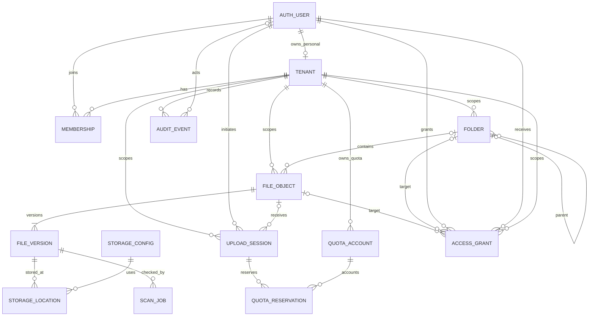

# SecureDrive PostgreSQL data model — MVP design

**Status:** approved MVP model implemented additively; migrations and tests are in the repository. PostgreSQL deployment remains gated on review and validation against a disposable database.

**Repository baseline:** Django's built-in `auth.User` is currently used. `Folder` and `File` have `owner` FKs, folders have self-parent, files have optional folder, and both have `deleted_at`. `File` stores a `FileField` path, plaintext size/MIME/hash, and AES-GCM metadata (`wrapped_dek`, nonces, encryption version). `Share` grants viewer/editor to a receiver user and targets exactly one file or folder. `ActivityLog` is user/action/free-text description plus optional generic content-type/object ID. PostgreSQL is configured, but the current file bytes are stored under Django `MEDIA_ROOT`; there are no Tenant, Membership, quota, upload session, file version, storage adapter, scan, or backup-job models.

Sources: [Django settings](../backend/securedrive/settings.py), [Folder](../backend/folders/models.py), [File](../backend/files/models.py), [Share](../backend/sharing/models.py), [ActivityLog](../backend/logs/models.py), [API contract](./API_CONTRACT_V1.md).

## Implementation notes

- Existing `auth.User`, integer `File`/`Folder` identifiers, file-path storage, encryption fields, `Share`, and `ActivityLog` are retained. No existing field is renamed or removed, no file bytes are copied, and no duplicate access-grant or audit table is introduced.
- New personal tenants, owner memberships, and initially unmetered tenant quota accounts are created for existing users. Existing folders/files are mapped by their owner. Existing shares are scoped to their target resource; legacy activity is attributed to the actor's personal tenant where available.
- Existing file metadata is represented by a version-1 metadata row and a `pending` storage location referencing the existing Django storage path. Missing paths produce a `failed` version without a location. This does not verify that bytes exist; a storage reconciler must verify them before marking content available.
- Legacy quota `used_bytes` is initialized from all existing file sizes, including trashed files; retention/purge policy remains a separate service decision. Tenant quota limits start unset. Business uploads require both a tenant quota account and an explicit member allocation in the quota service.
- PostgreSQL-only composite foreign keys enforce same-tenant parents, file/folder/version/storage/upload/reservation relationships and owner membership. They are skipped on SQLite, so SQLite tests do not certify database-level tenant isolation.
- Backfills fail closed on legacy live sibling-name collisions, cross-owner folder placements, negative file sizes, duplicate storage paths, or unresolved share targets. Resolve those data cases and retry; migrations do not rename, delete, or move existing user content.
- Backfill migrations are intentionally irreversible because derived version/storage metadata may be used after deployment. Rollback guidance is to restore the pre-migration database and matching media backup, or deploy a forward fix; do not reverse through the data migrations.
- Read-only DRF serializers expose only allowlisted metadata. They are not wired to new API endpoints in this data-model task.

## 1. Design principles and scope

- Preserve `auth.User` for MVP. Use its current integer primary key for foreign keys; do not swap `AUTH_USER_MODEL` after existing migrations without a separate migration plan.
- Every Drive resource belongs to exactly one **Tenant namespace**. An individual account receives a personal tenant; a business workspace is a business tenant. All folders, files, versions, upload sessions, quota, storage locations and shares have a non-null `tenant_id`.
- Tenant membership and role are resolved on the server for every request. The API does not accept client-selected `tenant_id`, `owner_id`, storage provider, bucket, key or credential as authorization input.
- A user can be a member of more than one tenant (including their own personal tenant). A current tenant/workspace context selects the scope; access is still checked against membership and resource policy, never trusted just because a client sent a tenant ID.
- No file bytes in PostgreSQL. PostgreSQL holds metadata and server-managed object references only.
- Use UUIDs for new public-facing identifiers to reduce accidental enumeration; existing integer file/folder IDs can be retained during a staged migration and replaced only through a reviewed compatibility plan.
- Prefer a small static permission vocabulary for MVP. Do not add generic Role/Permission/Group tables until product requirements need custom roles or user groups.
- `DateTimeField`/`timestamptz` values are UTC (`USE_TZ=True`); serialize ISO-8601 UTC. Do not store local time in a timestamp column.
- Data consistency across PostgreSQL and object storage is workflow/reconciliation-based, not a shared ACID transaction.

### Individual versus Business

`Tenant.kind` is the source of truth: `personal` or `business`. Each individual has one `personal` tenant with a unique `personal_owner_id`; business tenants have no `personal_owner_id` and are entered through active `Membership` rows. A user account itself is not inferred as individual/business by email or URL. A user may have a personal tenant and business memberships. Plan/quota policy attaches to the selected tenant, with the business tenant/member allocation taking precedence for that workspace.

Membership roles are a bounded choice (`owner`, `admin`, `member`) with authorization rules in backend services. Do not create arbitrary role records or allow role changes from ordinary member APIs.

## 2. ERD

`AUTH_USER` is Django's existing table. `SCAN_JOB` is shown for a future scanner integration and is deferred from the minimum operational MVP unless scanning is a release gate. `UPLOAD_PART` is not shown in the default MVP ERD because the current server-proxied upload is a single request; it is described as an optional extension in §5.

## 3. MVP relational tables

Types below are PostgreSQL types. Django field equivalents should use UUIDField, BigAutoField-compatible FK, BigIntegerField, DateTimeField, TextChoices/CharField, BinaryField, and JSONField as appropriate. All timestamps are `timestamptz`; `NOT NULL` is explicit.

### 3.1 Existing authentication principal: `auth_user` (retain)

| Field | PostgreSQL type | Null? | Constraint / index |
|---|---|---:|---|
| `id` | `bigint` | no | Existing Django PK; retain for compatibility. |
| `username` | `varchar(150)` | no | Existing unique constraint/index. |
| `email` | `varchar(254)` | no | Existing Django field is not guaranteed unique; do not assume unique. Add uniqueness only after a reviewed duplicate cleanup and product decision. |
| `password` | `varchar(128)` | no | Django password hash only; never store plaintext. |
| `is_active`, `is_staff`, `is_superuser` | `boolean` | no | Existing auth flags. `is_staff` is not a tenant role. |
| `date_joined`, `last_login` | `timestamptz` | per Django | Existing auth lifecycle. |

Use Django permissions for site-admin access. Do not copy password/session secrets into custom account tables. Session records remain Django's session backend and are not included in this domain ERD.

### 3.2 `drive_tenant`

| Field | PostgreSQL type | Null? | Constraint / index |
|---|---|---:|---|
| `id` | `uuid` | no | PK, generated server-side. |
| `kind` | `varchar(16)` | no | Check: `personal` or `business`. |
| `name` | `varchar(255)` | no | Trimmed, non-empty. |
| `slug` | `varchar(100)` | yes | Unique for non-null values if user-facing URLs need it; otherwise defer. |
| `personal_owner_id` | `bigint` | yes | FK `auth_user(id) ON DELETE RESTRICT`; must be set iff `kind='personal'`; unique partial index where not null. |
| `status` | `varchar(16)` | no | `active`, `suspended`, `deletion_pending`; default `active`. Check constraint. |
| `created_at`, `updated_at` | `timestamptz` | no | UTC, database/default application-managed creation/update. |

Constraints: `CHECK ((kind='personal' AND personal_owner_id IS NOT NULL) OR (kind='business' AND personal_owner_id IS NULL))`; `UNIQUE(personal_owner_id) WHERE personal_owner_id IS NOT NULL`. The unique owner constraint means at most one personal tenant per user; backfill should create exactly one for each existing user.

### 3.3 `drive_membership`

| Field | PostgreSQL type | Null? | Constraint / index |
|---|---|---:|---|
| `id` | `uuid` | no | PK. |
| `tenant_id` | `uuid` | no | FK `drive_tenant(id) ON DELETE RESTRICT`. |
| `user_id` | `bigint` | no | FK `auth_user(id) ON DELETE RESTRICT`. |
| `role` | `varchar(16)` | no | Check: `owner`, `admin`, `member`. |
| `status` | `varchar(16)` | no | Check: `active`, `invited`, `suspended`, `revoked`; default `active`. |
| `created_at`, `updated_at` | `timestamptz` | no | UTC. |

Constraints/indexes: unique `(tenant_id,user_id)`; index `(user_id,status)` for workspace discovery; index `(tenant_id,status,role)` for admin and authorization queries. For a personal tenant, membership user must equal `personal_owner_id` and role must be `owner`; enforce through a transaction/service and preferably a deferred DB trigger because the cross-table condition cannot be expressed as an ordinary row `CHECK`. Business tenants must have at least one active owner; enforce transactionally and test last-owner protection.

### 3.4 `drive_folder`

| Field | PostgreSQL type | Null? | Constraint / index |
|---|---|---:|---|
| `id` | `uuid` | no | PK; generated server-side. |
| `tenant_id` | `uuid` | no | FK `drive_tenant(id) ON DELETE RESTRICT`. |
| `owner_id` | `bigint` | no | FK `auth_user(id) ON DELETE RESTRICT`; creator/current owner, not authorization proof by itself. |
| `parent_id` | `uuid` | yes | Self-FK `drive_folder(id) ON DELETE RESTRICT`; null is tenant root. |
| `name` | `varchar(255)` | no | Trimmed and non-empty; prohibit path separators/control characters per shared name policy. |
| `created_at`, `updated_at` | `timestamptz` | no | UTC. |
| `last_accessed_at` | `timestamptz` | yes | UTC; update only on intended access events. |
| `deleted_at` | `timestamptz` | yes | Soft-delete timestamp; null means live. |
| `purge_after` | `timestamptz` | yes | Set when trashed under retention policy; null while live. |

Constraints/indexes:

- Composite unique `(tenant_id,id)` to support tenant-consistent composite foreign keys.
- Case-insensitive live-name uniqueness within parent: unique `(tenant_id, COALESCE(parent_id, zero_uuid), lower(name)) WHERE deleted_at IS NULL`. Reserve the sentinel UUID so it cannot be a real folder ID. Use a PostgreSQL expression/partial unique index; do not rely on a pre-insert `exists()` check alone.
- Index `(tenant_id,parent_id,deleted_at,lower(name))` for listing; `(tenant_id,owner_id,deleted_at)` for owned view; `(tenant_id,purge_after) WHERE deleted_at IS NOT NULL` for retention.
- Enforce parent tenant equals child tenant with composite FK `(tenant_id,parent_id) -> drive_folder(tenant_id,id)` while preserving nullable root; ensure no cycles in service transaction and test recursion limits.

`owner_id` denotes the user who created/owns the object under current product rules. For a business workspace, authorization/quota is tenant membership plus role; uploader does not become tenant admin.

### 3.5 `drive_file`

| Field | PostgreSQL type | Null? | Constraint / index |
|---|---|---:|---|
| `id` | `uuid` | no | PK; generated server-side. |
| `tenant_id` | `uuid` | no | FK `drive_tenant(id) ON DELETE RESTRICT`. |
| `owner_id` | `bigint` | no | FK `auth_user(id) ON DELETE RESTRICT`. |
| `folder_id` | `uuid` | yes | FK to same-tenant `drive_folder`; null means tenant root. |
| `name` | `varchar(255)` | no | Display name; safe-name policy. |
| `state` | `varchar(20)` | no | Check: `pending`, `available`, `failed`, `trashed`, `deleting`; do not expose `available` before file version integrity checks and required scans. |
| `created_at`, `updated_at` | `timestamptz` | no | UTC. |
| `last_accessed_at` | `timestamptz` | yes | UTC. |
| `deleted_at` | `timestamptz` | yes | Soft-delete time; null means live. |
| `purge_after` | `timestamptz` | yes | Retention expiry; set with deletion. |

Constraints/indexes:

- Composite unique `(tenant_id,id)`.
- Composite FK `(tenant_id,folder_id) -> drive_folder(tenant_id,id)` so a file cannot point across tenant boundaries.
- Unique live sibling names: `(tenant_id,COALESCE(folder_id,zero_uuid),lower(name)) WHERE deleted_at IS NULL`. Reserve the sentinel UUID so it cannot be a real folder ID. Files and folders are different tables, so this alone does not prevent a same-name file and folder in one location. **Open:** allow a file and folder to share a name, or add a common namespace table/trigger to enforce cross-type uniqueness.
- Index `(tenant_id,folder_id,state,lower(name)) WHERE deleted_at IS NULL`; `(tenant_id,owner_id,deleted_at)`; `(tenant_id,purge_after) WHERE deleted_at IS NOT NULL`.
- Do not duplicate bytes or large content in this row. Current format fields move to `drive_file_version`.

### 3.6 `drive_file_version`

| Field | PostgreSQL type | Null? | Constraint / index |
|---|---|---:|---|
| `id` | `uuid` | no | PK. |
| `tenant_id` | `uuid` | no | FK tenant `ON DELETE RESTRICT`; repeated for tenant-consistent FK. |
| `file_id` | `uuid` | no | FK file `ON DELETE RESTRICT`; composite `(tenant_id,file_id) -> drive_file(tenant_id,id)`. |
| `version_number` | `integer` | no | Positive; unique `(file_id,version_number)`; MVP creates version 1 only unless user-visible revisioning is approved. |
| `state` | `varchar(20)` | no | Check: `pending`, `uploading`, `verifying`, `scanning`, `available`, `failed`, `deleting`. |
| `size_bytes` | `bigint` | no | `CHECK size_bytes >= 0`; confirmed actual plaintext size after validation. |
| `mime_type` | `varchar(100)` | no | Server-detected, not client-trusted. |
| `sha256` | `char(64)` | yes | Server-computed plaintext digest; index only if dedup/search needs it (dedup can leak equality and is deferred). |
| `is_current` | `boolean` | no | Default false; exactly one available current version per file once a file is available. |
| `encryption_scheme` | `varchar(32)` | no | E.g. `AES-256-GCM`; server chosen. |
| `encryption_version` | `smallint` | no | Positive format/key version. |
| `key_reference` | `varchar(255)` | yes | Non-secret KMS/key-version identifier only; never key material or credentials. |
| `created_at`, `verified_at` | `timestamptz` | no/yes | UTC. |
| `deleted_at` | `timestamptz` | yes | Version retention/deletion lifecycle if independently purged. |

Constraints/indexes: unique `(tenant_id,file_id,version_number)`; index `(tenant_id,file_id,version_number DESC)`; partial unique `(file_id) WHERE state='available' AND is_current`. A transaction locks the parent file row while switching `is_current`; the partial unique index prevents two current versions. The database constraint guarantees **at most** one current version; service transaction logic must ensure exactly one before setting the parent file available (or add a deferred constraint trigger if review requires DB-enforced exactness). For the smallest initial launch with no revisions, create version 1 only; version history and user-facing rollback can be deferred.

**Key handling:** never persist plaintext DEK/master key, raw KMS credentials or presigned URL. The existing code stores `wrapped_dek` and nonces in the database; it does not store plaintext DEKs. A wrapped DEK is still sensitive encrypted key material. Preferred target is a managed KMS/envelope-key service and a non-secret `key_reference`; if the selected KMS requires storing an encrypted data-key blob, review that explicitly as ciphertext key material, encrypt database backups, tightly restrict reads and do not describe it as a raw key. A schema migration alone cannot remove/replace the current wrapped-key behavior.

### 3.7 `drive_storage_config` and `drive_storage_location`

Storage configuration is operator-managed infrastructure, not a client-selectable target. MVP has one global local-filesystem configuration; future business-managed MinIO configurations require additional tenant admin and credential-reference policy.

#### `drive_storage_config`

| Field | PostgreSQL type | Null? | Constraint / index |
|---|---|---:|---|
| `id` | `uuid` | no | PK. |
| `tenant_id` | `uuid` | yes | FK tenant `ON DELETE RESTRICT`; null only for operator-global config. |
| `provider` | `varchar(16)` | no | Check: `local`, `s3`, `minio`. MVP current provider is `local`. |
| `status` | `varchar(16)` | no | `active`, `read_only`, `disabled`; check constraint. |
| `endpoint` | `varchar(512)` | yes | Non-secret endpoint metadata, never client controlled. |
| `credential_ref` | `varchar(255)` | yes | Opaque reference into a secret manager, not the credential itself. |
| `created_at`, `updated_at` | `timestamptz` | no | UTC. |

Indexes: unique global config for `(provider)` where `tenant_id IS NULL` if the deployment uses one per provider; index `(tenant_id,status)`. Do not place access keys, secret keys, passwords or encryption key bytes here.

#### `drive_storage_location`

| Field | PostgreSQL type | Null? | Constraint / index |
|---|---|---:|---|
| `id` | `uuid` | no | PK. |
| `tenant_id` | `uuid` | no | FK tenant `ON DELETE RESTRICT`. |
| `file_version_id` | `uuid` | no | FK version `ON DELETE RESTRICT`; composite tenant FK. |
| `storage_config_id` | `uuid` | no | FK config `ON DELETE RESTRICT`; config must be global or same tenant (cross-table invariant enforced in service/trigger). |
| `object_ref` | `varchar(512)` | no | Generated by trusted storage adapter; unique within storage config. It is an internal locator, not a client-supplied key or bearer credential; never expose in API/logs. |
| `state` | `varchar(20)` | no | `pending`, `available`, `delete_pending`, `deleted`, `error`; check constraint. |
| `size_bytes` | `bigint` | yes | Stored ciphertext bytes when known; nonnegative. |
| `checksum` | `varchar(128)` | yes | Storage checksum/algorithm, not a secret. |
| `created_at`, `updated_at`, `verified_at` | `timestamptz` | no/no/yes | UTC. |

Indexes: unique `(storage_config_id,object_ref)`; index `(tenant_id,file_version_id,state)`; index `(state,updated_at)` for reconciler. Retain the reference until storage deletion is confirmed; do not cascade-delete the reference before the external object cleanup succeeds.

### 3.8 `drive_upload_session` and quota reservations

#### `drive_upload_session`

| Field | PostgreSQL type | Null? | Constraint / index |
|---|---|---:|---|
| `id` | `uuid` | no | PK; opaque upload ID. |
| `tenant_id` | `uuid` | no | FK tenant `ON DELETE RESTRICT`. |
| `initiated_by_id` | `bigint` | no | FK user `ON DELETE RESTRICT`. |
| `target_folder_id` | `uuid` | yes | Same-tenant FK to live destination folder; null is tenant root. |
| `file_id` | `uuid` | yes | FK file `ON DELETE RESTRICT`; null until metadata row is created. |
| `client_name` | `varchar(255)` | no | Untrusted proposed display name; validated server-side. |
| `expected_size_bytes` | `bigint` | no | `CHECK >= 0`; capped by policy. |
| `expected_sha256` | `char(64)` | yes | Client hint only; must be recomputed/verified server-side. |
| `received_bytes` | `bigint` | no | Default 0, `CHECK 0 <= received_bytes <= expected_size_bytes`. |
| `state` | `varchar(20)` | no | Check: `initiated`, `uploading`, `verifying`, `scanning`, `completed`, `failed`, `canceled`, `expired`. |
| `failure_code` | `varchar(64)` | yes | Stable non-secret internal/public-safe code, no raw exception. |
| `expires_at` | `timestamptz` | no | UTC. |
| `created_at`, `updated_at`, `completed_at` | `timestamptz` | no/no/yes | UTC. |

Indexes: `(tenant_id,state,expires_at)` for cleanup; `(initiated_by_id,state,created_at)` for user manager; index `(file_id) WHERE file_id IS NOT NULL`. One file can receive multiple upload sessions over its lifecycle (for example, a future new version); a session creates at most one file/version. Validate membership, destination edit permission and quota in one transaction before accepting content. Do not persist presigned URLs. For current one-request server-proxied upload, set `received_bytes` only from server-observed bytes; progress is not fabricated.

#### `drive_quota_account`

Use one account row for tenant-wide quota and, only if per-member business allocations are required by policy, one row for each member allocation. Scope must be unambiguous.

| Field | PostgreSQL type | Null? | Constraint / index |
|---|---|---:|---|
| `id` | `uuid` | no | PK. |
| `tenant_id` | `uuid` | no | FK tenant `ON DELETE RESTRICT`. |
| `scope` | `varchar(16)` | no | `tenant` or `member`; check. |
| `user_id` | `bigint` | yes | FK user `ON DELETE RESTRICT`; required iff scope=`member`, null iff `tenant`. |
| `limit_bytes` | `bigint` | yes | Null means no assigned limit/unknown, not zero; otherwise `CHECK >= 0`. |
| `used_bytes` | `bigint` | no | Default 0; `CHECK >= 0`. |
| `reserved_bytes` | `bigint` | no | Default 0; `CHECK >= 0`. |
| `updated_at` | `timestamptz` | no | UTC. |

Constraints/indexes: check that `scope='tenant'` iff `user_id IS NULL`; unique tenant account per tenant via partial unique `(tenant_id) WHERE scope='tenant'`; unique member account `(tenant_id,user_id) WHERE scope='member'`; index `(tenant_id,user_id)`. For business uploads, reserve against both tenant row and member allocation row if both limits apply; for personal workspace reserve against its tenant account. The source of truth for `used_bytes` must be confirmed object versions in live/quota-counted lifecycle, not client reports.

#### `drive_quota_reservation`

| Field | PostgreSQL type | Null? | Constraint / index |
|---|---|---:|---|
| `id` | `uuid` | no | PK. |
| `upload_session_id` | `uuid` | no | FK `drive_upload_session(id) ON DELETE RESTRICT`. |
| `quota_account_id` | `uuid` | no | FK `drive_quota_account(id) ON DELETE RESTRICT`. |
| `reserved_bytes` | `bigint` | no | `CHECK >= 0`; zero-byte files are valid, though a zero reservation can alternatively be omitted consistently. |
| `state` | `varchar(16)` | no | `reserved`, `consumed`, `released`; check. |
| `created_at`, `finalized_at` | `timestamptz` | no/yes | UTC. |

Constraints/indexes: unique `(upload_session_id,quota_account_id)`; index `(quota_account_id,state)`. If one upload reserves tenant + member quota, it has one reservation per applicable account. Keep a row after consumption/release for reconciliation and auditability.

For a `scope='member'` quota account, enforce that `(tenant_id,user_id)` references an active membership; use a composite FK to membership if revoked memberships are retained (the FK can enforce identity, while service/trigger enforces active status), or restrict creation/update through a transactionally guarded service and a constraint trigger.

**Race-safe reservation algorithm:** in one PostgreSQL `transaction.atomic()`, identify applicable quota account rows server-side, lock them with `SELECT ... FOR UPDATE` in deterministic ascending UUID order, re-read `limit_bytes/used_bytes/reserved_bytes`, require `used + reserved + requested <= limit` for every finite account, increment `reserved_bytes`, create upload session and reservation rows, then commit. This serializes concurrent reservations for the same limit. On completion, while holding the same quota row locks, reconcile expected versus verified actual bytes, transition reservations to consumed, decrement `reserved_bytes` and increment `used_bytes` atomically with DB metadata finalization. On cancel/failure/expiry release reserved bytes exactly once. Use unique reservation constraints and terminal-state checks to make retries safe. A periodic reconciler recomputes counters from file versions and active reservations; do not use check-then-insert without locks.

### 3.9 `drive_access_grant` (MVP sharing, if retained)

Sharing already exists as user-level Viewer/Editor shares, so retain a normalized grant table rather than adding group/role systems. Initial MVP supports direct user recipient only; link/public shares and group grants are deferred.

| Field | PostgreSQL type | Null? | Constraint / index |
|---|---|---:|---|
| `id` | `uuid` | no | PK. |
| `tenant_id` | `uuid` | no | FK source resource tenant `ON DELETE RESTRICT`. |
| `granted_by_id` | `bigint` | no | FK user `ON DELETE RESTRICT`. |
| `recipient_user_id` | `bigint` | no | FK user `ON DELETE RESTRICT`. |
| `file_id` | `uuid` | yes | FK file `ON DELETE RESTRICT`. |
| `folder_id` | `uuid` | yes | FK folder `ON DELETE RESTRICT`. |
| `permission` | `varchar(16)` | no | Check: `viewer`, `editor`. |
| `created_at`, `updated_at`, `revoked_at` | `timestamptz` | no/no/yes | UTC; revocation is soft state for history. |

Constraints: exactly one target (`CHECK ((file_id IS NULL) <> (folder_id IS NULL))`); composite tenant FKs on each target; unique active grant per target+recipient with partial unique indexes; indexes `(recipient_user_id,revoked_at)`, `(tenant_id,granted_by_id,revoked_at)`, and target lookup. A cross-tenant share is an explicit grant to a recipient user; the resource remains in its owning tenant. Do not copy the resource into the recipient tenant or trust the recipient's tenant context for access. Every read/write resolves effective grant and inherited folder policy server-side. For a folder-tree mutation, verify permissions over the entire affected subtree.

Current model enforces XOR and uniqueness but uses cascading deletes and has no tenant ID or revocation timestamp. Migration should preserve/translate existing shares; do not silently broaden access.

### 3.10 `drive_audit_event`

| Field | PostgreSQL type | Null? | Constraint / index |
|---|---|---:|---|
| `id` | `uuid` | no | PK, immutable event ID. |
| `tenant_id` | `uuid` | yes | FK tenant `ON DELETE SET NULL` only for global auth events; tenant-scoped events must be non-null at write time. |
| `actor_user_id` | `bigint` | yes | FK user `ON DELETE SET NULL`; preserve audit after account deletion. |
| `action` | `varchar(48)` | no | Bounded enum/string; e.g. login/logout/upload/download/move/trash/restore/quota/admin actions. |
| `resource_type` | `varchar(32)` | yes | Non-secret type label. |
| `resource_id` | `uuid` | yes | Logical ID only; intentionally no cascade FK so permanent deletion does not erase event history. |
| `request_id` | `varchar(64)` | yes | Random correlation ID, not session/token. |
| `metadata` | `jsonb` | no | Default `{}`; allowlist safe structured fields only; never passwords, tokens, presigned URLs, keys, file bytes, raw exception, storage reference. |
| `created_at` | `timestamptz` | no | UTC and immutable. |

Indexes: `(tenant_id,created_at DESC,id)` for admin search; `(actor_user_id,created_at DESC)`; `(tenant_id,action,created_at DESC)`; optional BRIN on `created_at` only at larger scale. Append-only in application code; DB role should deny UPDATE/DELETE to normal service user if operationally feasible. Retention/partitioning policy in §7. The existing generic `ActivityLog` has free-text descriptions; backfill actions and redact unsafe descriptions before migrating.

### 3.11 `drive_scan_job` (conditional MVP gate)

Only create this table if malware/content scanning is a release requirement and a real scanner/service is selected. Do not show `scanning` in client UI or mark files available based on a fake scan state.

| Field | PostgreSQL type | Null? | Constraint / index |
|---|---|---:|---|
| `id` | `uuid` | no | PK. |
| `tenant_id` | `uuid` | no | FK tenant `ON DELETE RESTRICT`. |
| `file_version_id` | `uuid` | no | FK version `ON DELETE RESTRICT`; same-tenant composite FK. |
| `state` | `varchar(16)` | no | `queued`, `running`, `clean`, `infected`, `error`, `skipped`; check. |
| `engine_name`, `engine_version` | `varchar(100)` | yes | Scanner identifiers, no credentials. |
| `result_code` | `varchar(64)` | yes | Safe normalized code; do not retain payload/signature details that expose internals. |
| `attempt_count` | `smallint` | no | Default 0; `CHECK >= 0`. |
| `created_at`, `updated_at`, `completed_at` | `timestamptz` | no/no/yes | UTC. |

Constraints/indexes: unique active scan per version/policy if retries update same row; `(state,created_at)` queue index; `(tenant_id,file_version_id)`. A clean result is required before `FileVersion.state='available'` only if product policy makes scan mandatory. If scanner outage behavior is fail-closed, keep file unavailable and retry; never treat errors as clean.

## 4. Considered but deferred models

| Candidate | MVP decision | Reason / activation condition |
|---|---|---|
| `Group` | Defer. | No product requirement or group-sharing API; direct user shares suffice for existing behavior. Add only when groups and group lifecycle are specified. |
| Generic `Role` / `Permission` tables | Defer. | Current access model needs fixed `owner/admin/member` membership roles and `viewer/editor` grants. Static choices plus centralized policy functions are simpler and testable. Add custom RBAC only for customer-defined roles/permissions. |
| `UPLOAD_PART` | Defer for single-request server-proxied upload. | No current resumable/chunk storage protocol. Add if upload-session design chooses chunks or direct multipart storage; fields should include session, part number, expected/received bytes, checksum, state and timestamps, unique `(session_id,part_number)`. Any provider upload token must be treated as secret if bearer-capable and stored encrypted or avoided. |
| `BackupJob` / backup policy tables | Defer from Drive domain. | Backups are platform operations, not user file metadata. Keep in ops/control-plane database or monitoring system if backup scheduling/status becomes an application feature. Never store backup credentials or backup bytes here. |
| `FileVersion` user-visible version history | Defer UI/history, retain metadata boundary if adopted. | Current `File` has one current blob. Add versions when version restore/audit requirements are defined. Do not claim historical versions based only on `updated_at`. |
| `ScanJob` | Conditional, not fabricated. | No scanner dependency/service was found. Create only with a real scanner and an explicit fail-open/fail-closed policy. |
| `IdempotencyRecord` | Add with API implementation if the API contract keeps idempotency guarantees. | Needed for retry-safe create/upload/admin mutations; not needed before API semantics are approved. Store request hash, scope/actor, response status/body reference and expiry; no credentials or bodies containing secrets. |
| `StorageOperation` outbox | Defer until asynchronous object operations need durable work scheduling. | Initial state fields plus a reconciler are sufficient for local filesystem flow. If storage work moves to a worker queue, add a transactional outbox with operation key, state, attempts and next retry. |

## 5. Object storage and workflow consistency

PostgreSQL transactions cannot atomically commit to an external filesystem/S3/MinIO. Use explicit state transitions and reconciliation:

1. Reserve quota and commit an upload session + pending file/version + server-generated storage reference before writing bytes.
2. Write encrypted bytes using a private storage adapter. Never let API clients select provider, bucket, path/object key or credentials.
3. Verify stored byte count/checksum and required encryption metadata. Run scan if mandated.
4. In one PostgreSQL transaction, mark storage location/version/file available and convert quota reservation to used bytes. A file is visible/downloadable only after the DB says `available`.
5. On a write failure, mark upload/version failed and schedule object cleanup; release quota once. Do not delete DB tracking before storage cleanup has been confirmed.
6. A periodic reconciler examines stale pending sessions, DB rows whose object is missing, objects with no live DB reference, delete-pending locations, quota-counter drift and versions stuck in verifying/scanning. It uses idempotent operations and records safe audit/metrics without logging object credentials, URLs or content.

For local `MEDIA_ROOT`, storage adapter operations are still outside the PostgreSQL transaction even though they share a host. Write temporary file then atomic rename on the same filesystem where supported; fsync/cleanup behavior and backup/restore consistency need operational tests. For object storage, use private buckets, server-generated opaque keys and least-privilege service credentials.

### File state versus upload-session state

- Session: `initiated -> uploading -> verifying -> [scanning] -> completed`; terminal alternatives are `failed`, `canceled`, `expired`.
- Version: `pending -> uploading -> verifying -> [scanning] -> available`; alternatives `failed`, `deleting`, `deleted`.
- File identity is `pending` until first available version; `available` after successful commit; `trashed` when soft deleted; `deleting` while purge is running.
- State changes are conditional updates (expected prior state) under transaction/row lock. Duplicate completion, cancellation and expiry must not double-consume/release quota.
- Progress is based on server-observed bytes or verified storage parts only. No speed/ETA/progress is inferred from client estimates.

## 6. Tenant integrity, FKs, deletion and indexes

### Tenant isolation constraints

Every tenant resource has `tenant_id NOT NULL`, including root folders/files, versions, upload sessions, quota accounts/reservations (through account), access grants and storage locations. Even personal resources use a personal tenant rather than `tenant_id=NULL`.

Use composite unique keys `(tenant_id,id)` and composite foreign keys for:

- `(folder.tenant_id, folder.parent_id) -> folder(tenant_id,id)`;
- `(file.tenant_id, file.folder_id) -> folder(tenant_id,id)`;
- `(version.tenant_id, version.file_id) -> file(tenant_id,id)`;
- `(storage_location.tenant_id, storage_location.file_version_id) -> version(tenant_id,id)`;
- `(upload.tenant_id, upload.target_folder_id) -> folder(tenant_id,id)`;
- target columns of `access_grant`.

Django's ordinary `ForeignKey` does not express all composite FK constraints. Options for review: add PostgreSQL composite constraints using carefully tested `RunSQL` migrations and reverse SQL, or add a narrow DB trigger where composite FK is impossible. Application/service checks remain necessary but do not replace DB constraints. Avoid cross-tenant generic `ContentType` relationships for primary access-controlled data.

All API queries start from server-derived active tenant membership/identity and then scope `tenant_id`; per-object permission services additionally check owner/share. A user-supplied ID is a lookup candidate only. Return the same not-found behavior for absent and inaccessible resources where existence disclosure is not permitted.

### ON DELETE policy

| Relationship | Proposed delete behavior | Rationale |
|---|---|---|
| Tenant -> memberships/resources/config/quota | `RESTRICT` in normal app path; explicit tenant deprovision workflow | Prevent accidental cascades over users/files/audit. |
| User -> membership/owner/grant actor/recipient | `RESTRICT` until explicit offboarding has reassigned/retained resources; audit actor uses `SET NULL`. | No silent data loss when a user is removed. |
| Folder -> parent/descendant | `RESTRICT`; use soft-trash subtree workflow. | Prevent breaking hierarchy on ordinary delete. |
| File -> versions/storage locations | `RESTRICT`; purge workflow deletes object bytes, then child metadata, then identity. | Keep references while external cleanup is pending. |
| Upload -> quota reservations | `RESTRICT`; terminal session/reservation retained for idempotency/diagnosis until expiry policy. | Avoid quota leaks on cascade. |
| File/folder -> access grant | `RESTRICT` or explicitly revoke before purge; retain a minimal revoked grant/audit record if required. | Avoid silent privilege changes and preserve audit. |
| User -> audit actor | `SET NULL`; preserve actor snapshot only if retention/privacy policy permits. | Keep audit event after account deletion. |
| Audit resource reference | No FK; type/id snapshot. | Permanent deletion must not cascade audit history. |
| Storage config -> location | `RESTRICT` while any location is live/pending. | No orphaned storage references. |

Normal user delete is soft state. Permanent deletion is an authorized, audited workflow, not a direct ORM cascade. Tenant/user hard-delete semantics must be approved separately.

## 7. Soft-delete, retention and UTC assumptions

### Proposed initial policy (review required)

- Folder/file delete sets `deleted_at` and `purge_after`; object bytes remain stored. Folder trash marks the live subtree and contained live files in one database transaction; restore checks parent order and name conflicts.
- Trashed items are hidden from normal listings and shares; a trash view is owner/tenant-scoped. Restore never overwrites a current item.
- Proposed MVP trash retention is **30 days**, after which an asynchronous purge job may begin. This is a proposal, not an existing repository behavior or legal commitment. Product/legal review must set the real value and whether expiry is automatic.
- Permanent purge marks `deleting`, deletes storage object idempotently, then removes version/location/file metadata after confirmed deletion. On failure keep the record and retry; do not report successful permanent deletion.
- Audit events are immutable and retained separately from user file data. Proposed audit retention is **365 days**, subject to legal/privacy requirements; no retention period is currently configured in the model.
- Upload sessions expire after a proposed **24 hours** without progress; clean staged bytes and release reservations through a reconciler. This must be aligned to future resumability and max file size.
- Membership removal revokes access immediately. Do not automatically delete the user's personal tenant or shared files.
- No bytes, credentials, raw encryption keys, presigned URLs or provider response bodies are stored in the domain tables.

All retention durations are explicit assumptions requiring approval; configure them centrally, not as unchangeable field defaults. Purge jobs must be observable and retryable.

## 8. Migration and rollout strategy (design only)

No migration should be generated or run before review. When approved, use staged, reversible where practical, additive migrations:

1. **Inventory and backup:** record counts, duplicate sibling names, orphan folders/files, invalid parent ownership, duplicate/invalid shares, and encryption/storage consistency. Take and verify a database + media backup; rehearse restore in non-production.
2. **Add tables:** create tenant, membership and new metadata tables; do not replace Django auth user. Add nullable `tenant_id` to existing Folder/File/Share only as a transitional field if in-place mapping is selected.
3. **Backfill:** create exactly one personal tenant and owner membership per existing user; assign each existing folder/file to that tenant. Verify every child folder and file tenant matches its parent/owner. Map existing File rows to `FileVersion` 1 and `StorageLocation` rows without moving bytes; retain original `file_path` as a temporary compatibility pointer.
4. **Share preservation:** add source tenant to each existing Share from its target, retain recipient identity/permission, reject or quarantine invalid owner/target mismatches; do not broaden access. Map old permission values to `viewer`/`editor`.
5. **Dual-read/write phase:** deploy code that writes old and new representations in one DB transaction where possible, reads new with explicit fallback/metrics, and keeps storage pointer unchanged. Avoid prolonged dual-write across unrelated stores.
6. **Validate and constrain:** compare row counts/checksums, test tenant isolation, clean collisions/orphans, add composite FKs and partial unique indexes (use PostgreSQL concurrent index build where supported and migration state is synchronized), then set tenant IDs `NOT NULL`.
7. **Cut over:** switch reads to new schema; monitor errors, quota drift and reconciler; remove compatibility reads/writes only after a documented rollback window. Keep reversible metadata migration where possible; file-byte operations require separate restore plan.
8. **Rollback:** code rollback must be possible without deleting newly written objects or losing audit. Database reverse migration must not drop populated tenant/version data. If destructive rollback cannot preserve state, use a forward-fix plan rather than pretending reverse is safe.

Test migrations against a disposable PostgreSQL database matching production major version, including composite FK SQL, partial/expression indexes, concurrent-index deployment behavior, lock duration and realistic row counts. Never run this migration plan directly against production as part of design review.

## 9. Deferred product and operations decisions

1. Should every user have a personal tenant, including a user who is only a business member? Recommended: yes; then business membership selects the business workspace and quota.
2. Which user is allowed to create business tenants, and how is the first business owner verified?
3. Can a user share across tenants? Existing sharing is by recipient user; recommended model allows explicit cross-tenant user grants while the source resource retains its tenant.
4. Are same-name file and folder siblings permitted? Existing checks are separate by model; a cross-type uniqueness invariant needs additional namespace design.
5. Should all file content become immutable version rows in the first schema migration, or should FileVersion wait until version history/upload workflow is selected? Recommended: include the metadata boundary only if migrating bytes/locations is already planned; otherwise defer to avoid an unnecessary backfill.
6. Is scan a mandatory release gate? Which scanner, failure policy, retention of scan evidence and retry semantics?
7. What is the exact Individual plan versus Business quota policy? Is business allocation only tenant-wide, or does each member get an explicit byte cap? If both, reserve both counters transactionally.
8. Is current wrapped-DEK storage acceptable as encrypted key material, or must key wrapping move to a KMS before this schema work? No raw key should be persisted either way.
9. What are approved trash, upload-session, audit and account-deletion retention periods?
10. Should audit history retain actor identity after deletion or only pseudonymized identity? Who can query global versus tenant event streams?
11. Are backup jobs an application feature or deployment/ops concern? Recommended: ops-only until customer-visible backup scheduling/restoration requirements exist.
12. Use UUIDs for old File/Folder records during backfill or retain integer IDs internally and expose opaque IDs via API? API contract currently proposes opaque public identifiers; migration compatibility needs an explicit choice.

## 10. Required data-model invariants/tests (minimum)

1. A personal tenant has exactly one personal owner, and one user cannot own two personal tenants.
2. Personal tenant owner has an active `owner` membership; membership cannot be reassigned to a different user via API.
3. Every live file/folder/upload/version/storage location has a non-null tenant.
4. A folder parent belongs to the same tenant; root parent is null only within that tenant.
5. A file's folder belongs to the same tenant, and owner/resource policy prevents cross-user mutation.
6. A file version references a file in the same tenant; a storage location references a version in the same tenant.
7. An upload destination folder, if supplied, is live and belongs to the upload tenant; caller has server-verified write permission.
8. A share has exactly one target; target tenant matches the recorded source tenant; a recipient cannot access after revoke or trash.
9. Viewer can read/download only; viewer cannot rename/move/copy/trash or create descendants.
10. A folder cannot be moved beneath itself or a descendant, even under concurrent operations.
11. At most one live same-type sibling name exists per tenant and parent, case-insensitively; concurrent creates are rejected by DB uniqueness, not merely application pre-check.
12. No upload reservation can make `used_bytes + reserved_bytes` exceed any finite applicable quota account.
13. Concurrent reservations lock tenant/member quota rows deterministically and cannot oversubscribe; duplicate reservation request is idempotent.
14. Cancel/failure/expiry releases each reservation exactly once; retrying the transition cannot underflow counters.
15. Completion consumes reservations and updates used bytes once; actual verified size cannot exceed reserved/allowed size.
16. A file/version cannot become available before object existence, integrity verification, encryption metadata validation and required scan policy complete.
17. A storage failure between object write and DB state commit is recoverable by reconciliation and never exposes a false available item.
18. Object deletion failure keeps a retryable `delete_pending` reference and does not claim permanent deletion.
19. Trash hides items from ordinary list/download/share access; restore fails on name conflict and cannot restore a child under a trashed parent.
20. Hard purge of files does not cascade-delete audit events; deleted actors become null/pseudonymized according to retention policy.
21. API attempts to choose `tenant_id`, `owner_id`, `bucket`, `object_key`, quota counters, states or storage credentials are rejected or ignored safely; they never override server-derived values.
22. Querying/listing, cursor pagination and unique constraints never leak another tenant's IDs, names, counts or existence.
23. `updated_at`, lifecycle timestamps and retention cutoffs are timezone-aware UTC; naive datetimes are rejected at service boundaries.
24. All uniqueness/FK/check constraints are enforced in PostgreSQL and covered by migration tests, not only model validation.
