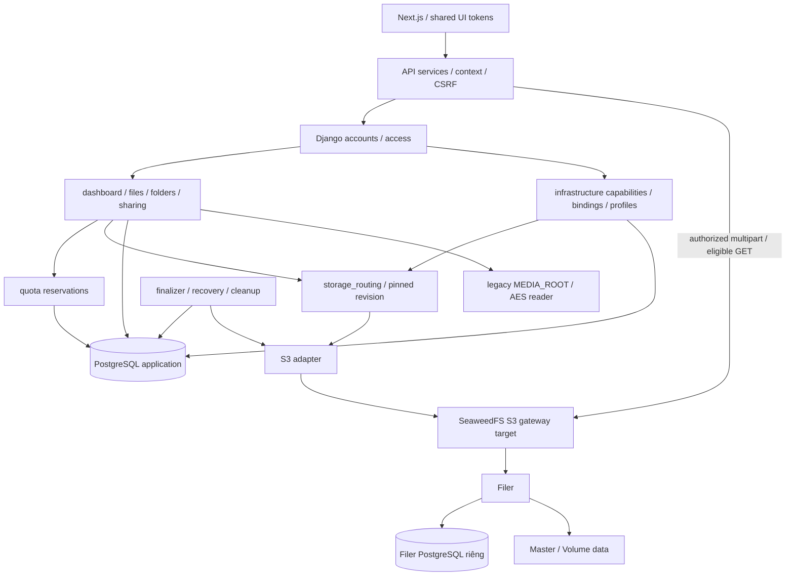

# BlueDrive — P0: Architecture Alignment & Implementation Baseline

> Bằng chứng P0 được giữ theo thời điểm kiểm tra. Các sửa chữa F10/F14/F15/F16/F18, phân loại đủ 75 failures/errors và kết quả tiếp nối nằm trong [P1 report](REFACTOR_P1_BASELINE_2026-11-16.md); không thay số liệu P0 bằng kết quả mới.

Ngày kiểm tra: **16/11/2026**, Asia/Bangkok. Phạm vi: working tree local, không phải chỉ HEAD và không phải chứng nhận production. **Chỉ triển khai tài liệu P0; P1–P8 bên dưới là đề xuất, chưa thực thi.** Quyết định đích tại [ADR-0010](ADR-0010-seaweedfs-enterprise-and-client-encryption-target.md). Quy trình: UNDERSTAND → PLAN → IMPLEMENT (tài liệu) → TEST → REVIEW → REPORT.

Kết quả P0: đã hoàn thành inventory/ADR/backlog và kiểm tra tài liệu. **Baseline ứng dụng chưa xanh:** full Django regression FAIL, index safety FAIL trên nội dung có sẵn, production build BLOCKED bởi font network. Không dùng việc hoàn thành P0 để nghiệm thu Enterprise/CSE/provider.

## 1. Hiện trạng, phạm vi và phương pháp

- Trước chỉnh sửa đã đọc `AGENTS.md`, `MAP.md`, `docs/DEVELOPMENT.md`, `frontend/AGENTS.md`, ADR liên quan, routes/callers/services/models/migrations/tests. Git đã có 149 tracked file thay đổi so với HEAD cùng nhiều file/thư mục untracked, gồm code, migration, CI, infra và tài liệu. Không stage/reset/stash/commit các thay đổi này.
- Kiểm kê dùng `rg`, đọc source theo đường vào và test; không suy unused từ tên file/import. Không có `graphify-out/graph.json`; dùng trace source có mục tiêu, không thêm graph/dependency chỉ để làm baseline.
- Chạy kiểm tra hiện có, dùng runner tạo database test riêng. Truy vấn inventory application DB nằm trong transaction `READ ONLY`, chỉ lấy tổng hợp không chứa tên user/file, ID, endpoint, credential hoặc signed URL.
- Không đổi nghiệp vụ, API, model, migration, dependency, flag vận hành, endpoint, credential, key hoặc dữ liệu ứng dụng. Hai lượt test chẩn đoán đặt giá trị flag riêng cho subprocess, ghi rõ ở §11; không đổi cấu hình/dịch vụ đang phục vụ. Không chạy finalizer/cleanup/probe trên DB phục vụ, không cutover hoặc reset DB. Command do tests gọi trong DB test không phải chạy worker trên DB phục vụ.
- Đích đã thống nhất khác implementation và khác runtime acceptance. Các báo cáo 07–13/11 là bằng chứng lịch sử; không tái dùng test count hoặc trạng thái vận hành của chúng như kết quả mới.

**Vấn đề / khuyến nghị:** nội quy cũ yêu cầu giữ lộ trình MinIO/cutover trong khi yêu cầu mới bỏ lộ trình này; code còn ưu tiên Personal Tenant và chưa có CSE. Giữ kiến trúc/module hiện có, ghi ADR thay thế từng phần và backlog có gate; tránh sửa nghiệp vụ trong một nhiệm vụ baseline. Giống kiểm kê nhà kho trước sửa: đánh dấu đúng phòng, đường đi và ổ khóa rồi mới duyệt việc xây lại.

## 2. Architecture inventory và dependency map

| Lớp / trách nhiệm | Source đang tồn tại | Đối chiếu kiến trúc đích |
| --- | --- | --- |
| Web runtime | `frontend/package.json`, `package-lock.json`, `app/layout.tsx`, `app/**/page.tsx` | Next.js 16.3.3, React 19.2.8; TypeScript/Tailwind. Giữ App Router. Poppins tải bằng `next/font/google`. |
| Client API / context | `frontend/lib/account-service.ts`, `drive-service.ts`, `workspace-service.ts`, `organization-admin-service.ts`, `workspace-context.ts`, `drive-paths.ts` | Request session/CSRF và Workspace selector dùng chung; default Enterprise chưa thống nhất với backend. |
| Upload UI / transport | `frontend/components/drive/UploadManager.tsx`, `upload-service.ts`, `upload-file-hash.ts`, `upload-resume-model.ts`, `browser/useDriveUploadIntake.ts` | Hash toàn file; chia part 8 MiB, resume receipts, polling tới available. Upload Blob hiện có chưa CSE. |
| Drive / sharing UI | `frontend/components/drive/DriveFileBrowser.tsx`, `browser/`, `FilePreviewDialog.tsx`, `ShareManagementDialog.tsx` | Tái dùng My Drive/Workspace browser; preview/ZIP/sharing cần contract CSE. |
| Organization / Admin UI | `frontend/components/organization/OrganizationAdminPage.tsx`, `components/admin/AdminResourceDirectory.tsx`, `app/(admin)/admin/organizations/page.tsx` | Directory Platform chỉ đọc; Organization quản lý Workspace/assignment, chưa full account provisioning. |
| Storage UI | `frontend/components/storage/StorageConnections.tsx`, `StorageManager.tsx`, `OrganizationStoragePage.tsx`, `TopologyCanvas.tsx`, `StorageMonitoring.tsx`, `PlatformClusterDashboard.tsx` | Dùng chung component theo scope; registration/read-check/probe/binding/topology/telemetry phải phân biệt. |
| Design system | `frontend/app/globals.css`, `frontend/lib/theme.ts`, `frontend/components/ui/{Button,Dialog,ConfirmDialog,DataTable,ContextMenu}.tsx` | Giữ Poppins, semantic token light/dark, control radius/motion/focus; không đưa UI library mới. |
| Backend entry / auth | `backend/securedrive/{settings,urls}.py`, `accounts/{urls,api_views,account_security_api,session_tracking,platform_admin_middleware}.py` | Django 5.2.17, DRF 3.18.0, session/CSRF; không tự đổi auth. URL hiện không có `/api/v1` chung. |
| Tenant / Workspace | `backend/accounts/{models,signals,services,access,workspace_api}.py` | Tenant personal/business, Membership, Workspace/WorkspaceMembership; Enterprise My Drive là gap, không thêm Organization model. |
| File/folder/listing | `backend/files/{models,views,services,rename_service,permanent_delete}.py`, `folders/{models,views,tree_service,archive_service}.py`, `dashboard/{views,drive_api}.py` | Tái dùng service và kiểm ACL; media legacy và S3 cùng tồn tại trong source. |
| Quota | `backend/files/quota.py`, `accounts/{quota_admin_api,organization_quota_api}.py`, `accounts/models.py` | Admission/reserved/consumed/released có transaction/locks. Workspace cộng tác và default My Drive tính quota khác nhau. |
| Upload / publication | `backend/files/upload_api.py`, `finalization.py`, `management/commands/{finalize_uploads,run_upload_finalizer,cleanup_uploads}.py` | Session + durable job; finalizer kiểm bytes/hash và quyền trước publication; chưa CSE. |
| Storage contract / routing | `backend/files/storage_adapters/{base,factory,s3_compatible}.py`, `storage_routing.py` | Giữ S3 adapter, immutable connection revision và version pin; không thêm provider SeaweedFS song song. |
| Infrastructure control plane | `backend/infrastructure/{models,api,connection_api,connections,connection_profiles,connection_probes,telemetry,telemetry_api,prometheus,platform_live}.py` | Inventory/capability/binding/probe/monitoring; metadata `ready` không chứng minh provider đang khỏe. |
| Sharing / encryption / audit | `backend/sharing/{models,api_views,services,policy}.py`, `security/{aes_service,hash_service}.py`, `logs/{models,services}.py` | Share theo tài nguyên và cây thư mục; AES server legacy; ActivityLog khác ClusterAuditEvent/PlatformAdminAuditEvent có scope riêng. |
| Test / CI | `infra/seaweedfs/regression.py`, `backend/**/test*.py`, `backend/tools/`, `frontend/**/*.test.mts`, `frontend/e2e/`, `.github/workflows/verify.yml` | CI safety/frontend; chưa có job Django/PostgreSQL. Provider/live browser là opt-in riêng. |



Các mũi tên tới SeaweedFS mô tả đích và contract; không xác nhận runtime physical provider chỉ từ nhãn `s3`. Khi sửa một luồng phải trace cả caller, service, quota, storage revision, worker và audit. Giống vận đơn đi qua quầy cấp phép, kế toán và kho: sửa mỗi màn hình không đổi được quyền sở hữu hàng.

## 3. Database, migration và storage inventory

### 3.1 Schema và trách nhiệm

| Nhóm | Model / migration evidence | Bất biến / phần cần kiểm |
| --- | --- | --- |
| Identity | `auth.User`, `accounts/models.py`: Tenant, Membership, TrackedAccountSession, PlatformAdminIdentity | User active + membership active + Tenant active; Platform admin riêng. |
| Collaboration | `accounts/models.py`: Workspace, WorkspaceMembership, WorkspaceInvite | Workspace thuộc Tenant, grant trực tiếp; không có Organization model thứ hai. |
| Quota | QuotaAccount/StoragePlan/StoragePolicy và audit trong `accounts/models.py`; QuotaReservation trong `files/models.py` | Tenant/member/workspace scope; không bỏ reservation khi retry. |
| Content | `files/models.py`: File/FileVersion; `folders/models.py`: Folder; `sharing/models.py`: Share | Owner CASCADE cần thiết kế offboarding; Tenant/Workspace PROTECT và constraint same-scope. |
| Publication | UploadSession/UploadFinalizationJob/StorageConfig/StorageLocation trong `files/models.py` | Session/location giữ revision và provider version; session/job không thay thế DB Filer. |
| Storage control | `infrastructure/models.py`: StorageCluster/Pool/Node/Disk/Binding/ConnectionRevision/Probe/PlatformStorageBinding/TelemetrySnapshot/Alert/AuditEvent | Platform cluster không có Tenant owner; Enterprise phải có business Tenant; grant content không thay grant storage. |
| Migration guards | `files/migrations/0011_add_tenant_composite_foreign_keys.py`, `0014_workspace.py`, `0017_pin_storage_targets.py`; `infrastructure/migrations/0004_pinned_target_integrity.py`, `0006_allow_deleted_upload_history.py` | PostgreSQL FK/trigger ngoài ORM; SQLite không chứng nhận. Không reverse khi successful history đã tháo FK. |
| Provider hiện tại | `files/migrations/0018_s3_only_provider.py`, `infrastructure/migrations/0008_s3_only_provider.py` | Các migration **đã có trước P0** giới hạn provider=`s3`; không chứng minh endpoint brand, không tạo migration P0. |

### 3.2 Quan sát application DB local, chỉ đọc ngày 16/11/2026

PostgreSQL **18.6**; `MigrationExecutor.migration_plan(leaf_nodes)` rỗng. Đây là DB được diagnostic process cấu hình, không xác nhận process đang phục vụ dùng cùng cấu hình. Không xuất DSN/host/user/password. Tất cả query trong transaction `SET TRANSACTION READ ONLY`.

| Model | Số bản ghi | Phân nhóm an toàn |
| --- | ---: | --- |
| Tenant / Membership | 5 / 5 | 5 personal; **0 business** |
| Workspace / QuotaAccount | 19 / 19 | 5 default, 14 không default |
| File / Folder / FileVersion | 1 / 0 / 1 | Version hiện có `is_encrypted=false` |
| StorageConfig / StorageLocation | 1 / 1 | Config provider=`s3` |
| UploadSession / FinalizationJob | 2 / 2 | Session: 1 available, 1 failed |
| QuotaReservation | 2 | 1 consumed, 1 released |
| StorageCluster / ConnectionRevision | 1 / 2 | 1 platform cluster ready; revision: 1 ready, 1 failed |
| StorageBinding / PlatformStorageBinding | 0 / 1 | Không có Enterprise binding |
| ActivityLog / Share | 7 / 0 | Không xuất nội dung hoặc actor |

Inventory diagnostic process đọc các cờ hiện có: direct download, control center, multi-cluster routing, runtime probes **true**; LAB probes và monitoring **false**. Source default vẫn OFF (`backend/securedrive/settings.py:162` trở đi). Trong inventory và full regression, chỉ `DEBUG=true` được đặt riêng cho process theo runbook HTTP development; các lượt test chẩn đoán sau dùng flag source default như §11. Không đổi file env hoặc cờ rollout của process phục vụ. Không suy frontend/backend/worker runtime đã đồng bộ từ những giá trị này.

### 3.3 Storage deployment inventory

| Đích / dữ liệu | Evidence source | Trạng thái bằng chứng hôm nay |
| --- | --- | --- |
| Platform SeaweedFS | `infra/seaweedfs/compose.yml`: 4.53, Master, 3 Volume services, Filer, S3, PostgreSQL 17-alpine; project/network/volumes riêng | Source/runtime inventory **PASS có giới hạn**: Docker quan sát 8 container running/healthy, có **4** Volume servers (thêm volume4 so với Compose nguồn, F19). S3 publish loopback :8333; Master :9333. Không khởi động/restart service. |
| Enterprise Lab | `infra/enterprise-lab/compose.yml`: project `bluedrive-enterprise-lab`, Master/Volume/Filer/S3/PostgreSQL riêng, loopback :8433 | `docker ps -a` quan sát 5 container đều Exited; Volume exit 137, các service khác exit 0. Mount/network names tách Platform; không suy credential isolation hoặc nguyên nhân dừng. Không restart để test. DB ứng dụng chưa có Tenant business để nghiệm thu end-to-end Enterprise. |
| Filer metadata DB | Hai Compose mount `.local/bootstrap.sql`, `.local/filer.toml`, volume postgres_data riêng; `infra/seaweedfs/configure.py` sinh role/schema | Platform đọc `BEGIN READ ONLY`: PostgreSQL **17.11**, `public.filemeta` **50 rows**, table owner `seaweedfs_filer`. Không đọc private config, không kiểm login role Filer qua password hoặc backup/restore. Enterprise DB dừng nên chưa query. Không cộng record Filer vào file/quota Django. |
| Legacy media | `backend/securedrive/settings.py` MEDIA_ROOT; `files/views.py:file_upload`; `folders/views.py:folder_upload`; `security/aes_service.py` | Có route và reader/write code; chưa duyệt xóa. Không đọc bytes runtime để kiểm kê P0. |
| MinIO cũ | `backend/minio-compose.yml`, CORS/policy đã bị xóa trong diff có sẵn; `files/tests/test_minio_storage_integration.py` vẫn có opt-in suite | Không nằm trong đích. Không có evidence provider đang chạy; không dừng/xóa/copy dữ liệu. Phân loại test theo từng hành vi S3 trước loại bỏ tên/provider cũ. |
| Công cụ cutover cũ | `MAP.md`, `backend/README.md`, ADR-0008/runbook trước P0 có dẫn `files/storage_cutover.py`, `audit_storage_cutover`, `migrate_platform_storage` | `rg --files backend` không có các module/commands đó. Sửa entry point hiện hành, giữ lịch sử, không phục hồi công cụ ngoài yêu cầu. |

Docker CLI không có trong PATH; đường dẫn fallback được handoff ghi là `C:\Users\dang2\AppData\Local\Programs\DockerDesktop\resources\bin\docker.exe`. Sandbox ban đầu từ chối truy cập đường dẫn; các lệnh **chỉ đọc** sau đó chạy qua quyền công cụ và thành công, không đổi dịch vụ. Không coi thông báo wrapper “absent” sau lỗi access-denied là bằng chứng executable không tồn tại.

Image IDs của 8 container Platform khớp local RepoDigests:

- SeaweedFS: `chrislusf/seaweedfs@sha256:ccad23e18639c8b98cee17e7100b95830a06077b56d8e5b006d6dcf8ec5e94a0`.
- PostgreSQL: `postgres@sha256:e5d2edd28b1f8d40a0a6c0c9cdc545b19b56a0d5d88f94bc11a97d970d4700d0`.

Mount inventory: Platform network `bluedrive-seaweedfs_storage`, named volumes `bluedrive-seaweedfs_{postgres,master,filer,volume,volume2,volume3,volume4}_data`; Enterprise network `bluedrive-enterprise-lab_storage`, named volumes `bluedrive-enterprise-lab_{postgres,master,filer,volume}_data`. Hai S3 containers còn có anonymous `/data` volume. Chỉ đọc type/name/destination/network và image ID; không dump container environment, credential/config contents hoặc volume bytes. Không đo được dung lượng object/volume, số object versions, orphan và backup coverage hôm nay. Tổng DB nhỏ không đại diện tải sản phẩm; `filemeta` row không tương ứng 1:1 với File Django.

## 4. API / permission matrix

Đây là các **route family hiện hữu**, không đề xuất `/api/v1`. Đọc route đầy đủ tại `backend/{securedrive,accounts,dashboard,files,folders,sharing,infrastructure}/urls.py`; methods và guards ở handler nêu dưới. “Owner” trong Workspace có thể là người tạo file; quyền cộng tác vẫn phải qua policy, không chỉ so owner ID.

| API / thao tác | Actor được phép hiện tại | Điều kiện từ chối / gate | Handler / caller evidence |
| --- | --- | --- | --- |
| `/accounts/api/csrf/`, `register/`, `login/`; `me/`, `logout/` | Public bootstrap/auth; me/logout cần session | Login/register có CSRF riêng; inactive bị chặn; auth không cấp content/storage capability | `accounts/api_views.py:27`, `:56`, `:125`, `:200`; `frontend/lib/{account-service,auth-service}.ts` |
| `/accounts/api/me/security/*`, `me/quota/`, `me/activity/`, `me/delete-data/` | Chính user, session/CSRF cho mutation; password cho thao tác cần reauth | Không được suy quyền xóa Organization data từ “my data”; default context cần rà P2 | `accounts/{account_security_api,settings_api}.py`; `frontend/components/account/`, `lib/account-security-service.ts` |
| GET `/drive/api/items/`, `/folder-tree/` | User active, Workspace role viewer/editor/admin hoặc quyền share thích hợp | Tenant/Workspace khác, archived, deleted ancestor; selector không cấp quyền | `dashboard/{views,drive_api}.py`; `accounts/access.py`; `sharing/services.py`; `frontend/lib/drive-service.ts` |
| Rename/move/duplicate/trash/restore/delete/star `/drive/api/items/*` | Theo ACL thao tác; editor/admin có quyền cộng tác; share editor tùy tài nguyên/cây | Phải kiểm cả nguồn/đích và từng item; batch không tự mở scope; star theo user | `dashboard/drive_api.py`, `files/{rename_service,permanent_delete}.py`, `folders/tree_service.py` |
| POST `/files/api/uploads/` | User active, active Tenant membership, Workspace editor/admin; folder phải writable | Quota thiếu/hết, selector sai, business binding thiếu khi routing ON; không nhận bucket/key/owner tùy ý | `files/upload_api.py:create_upload`, `files/quota.py:reserve_upload_quota`; `frontend/components/drive/upload-service.ts` |
| GET status/list parts; POST authorization(s)/complete/abort dưới `/files/api/uploads/<uuid>/` | Chính initiator còn quyền trong scope; write checks theo handler | Session của người khác, scope revoked/archived; complete không tự available, phải qua job/finalizer | `files/upload_api.py:_owned_session`, `authorize_part`, `authorize_parts`, `complete_upload`, `abort_upload` |
| GET `/drive/files/<id>/download-url/` | Owner/collaborator/share recipient còn view permission | Encrypted legacy/flag OFF/metadata chưa đủ dùng backend; phải pin version thật, cookie-isolated endpoint; sai scope/tài nguyên bị chặn | `files/views.py:614`; `files/tests/test_presigned_download.py`; `frontend/lib/drive-service.ts` |
| Download/view/details, folder/ZIP/shared bulk download | View ACL của từng tài nguyên và ancestor | Trashed/invalid chain, revoked share, wrong Workspace; preview MIME/size policy riêng | `files/views.py`, `folders/{views,archive_service}.py`, `sharing/views.py`; `lib/{file-preview-policy,drive-download-policy}.ts` |
| POST `/drive/upload/`, `/drive/folder-upload/` (legacy) | Guard/ACL và quota của legacy view | Vẫn là route reachable; không coi bỏ UI là đã tắt. Cần rà compatibility trước retirement | `files/urls.py`, `folders/urls.py`, tương ứng `views.py` |
| `/drive/api/shares/`, share file/folder, revoke/permission | Chủ sở hữu đủ quyền theo share service; recipient chỉ dùng share được cấp | Workspace editor không mặc nhiên được grant share cho file người khác; child share có thể override inherited permission | `sharing/{api_views,views,services}.py`; `frontend/lib/share-policy.ts`, `share-service.ts` |
| GET `/accounts/api/tenants/<tenant>/members/`; GET/POST workspaces; PATCH Workspace; POST/DELETE assignments | Active business owner/admin, hoặc Workspace manager với route cho phép | Cross-tenant/inactive bị từ chối; members endpoint chỉ GET, không tạo account | `accounts/workspace_api.py:44`, `:177`, `:203`, `:324`, `:405`; `frontend/lib/organization-admin-service.ts` |
| `/accounts/api/workspaces/<id>/members/<assignment>/` PATCH/DELETE; invites/accept | Workspace manager; invitation người nhận đủ điều kiện | Route UUID-based có self-change/revoke và Organization owner/admin protection, giữ manager cuối. Route DELETE tenant-scoped cũ chưa cùng guards (F17). **Chưa có Enterprise approval request** | `accounts/workspace_api.py:526`, `:600`, `:850`; `test_workspace_member_management.py` |
| POST Tenant memberships suspend/restore | Active business owner/admin; target ordinary member | Khóa Tenant/membership, không đổi global user identity; không phải full offboarding/key transfer | `accounts/api_views.py:301`, `:314`, `:323` |
| `/accounts/api/admin/{users,organizations,workspaces,files,audit,activity,quotas,...}/` | Dedicated Platform Admin; mutation có capability/super-admin guard tùy API | Không suy org content/storage access từ Platform role; directory organizations hiện GET-only; mutation yêu cầu CSRF/reason theo handler | `accounts/{admin_api,admin_files_api,admin_logs_api,quota_admin_api,platform_admin_provisioning}.py` |
| Platform `/accounts/api/admin/storage/*`; Organization `/accounts/api/tenants/<tenant>/storage/*` | Platform admin xem/monitor Platform; Platform super admin configure. Organization explicit `storage.view/configure/monitor` | Platform admin bị chặn route Organization; owner/admin content không tự có storage grant; cluster scope luôn do server lọc | `infrastructure/api.py:35`, `:57`; `connections.py:require_configure`; `frontend/lib/storage-control-service.ts` |
| profiles/connect/revisions/verify/probe/binding | Configure capability + approved profile, CSRF/reason; probe thêm flag/mode/receipt | Read check ≠ ready; probe ghi fixture, không chạy trong P0; binding không tự bật routing | `infrastructure/connection_api.py:24`, `:65`, `:71`, `:93`, `:110`, `:170`; `connection_probes.py` |
| topology/layout; telemetry/stream/alerts/ack | View cho topology/personal layout; configure shared layout; monitor theo capability | Position-only, optimistic revision; thiếu/stale telemetry là Unknown; SSE phải recheck quyền | `infrastructure/{api,telemetry_api,telemetry}.py`; `frontend/components/storage/TopologyCanvas.tsx`, `frontend/components/storage/useStorageTelemetry.ts` |

**Ma trận âm bắt buộc cho phase sau:** anonymous, inactive user, Tenant suspended, membership revoked, owner, viewer, editor, manager, Organization owner/admin, Platform admin/super admin, explicit storage grantee; cùng item ở Tenant/Workspace khác, selector body/query/header mâu thuẫn, quyền bị thu hồi sau khi ký URL/trước publication. Share recipient có chính sách riêng; không áp luật “mọi read phải là member cùng Tenant” để vô tình phá share. URL đã cấp có thời gian sống, thu hồi membership chỉ ngăn cấp mới; cần chính sách TTL được duyệt. Giống thẻ ra vào và vé giao hàng: hủy thẻ chặn xin vé mới nhưng vé đã phát cần quy tắc hết hạn riêng.

## 5. Data flow và failure modes

### Luồng đang có

1. Browser hash file → POST create → Django resolve Tenant/Workspace/ACL → `upload_target()` chọn revision → reserve quota và initiate multipart. `files/upload_api.py:_initialize_upload_session` còn RPC trong transaction; cần đo contention trước thay đổi.
2. Browser xin URL part, gửi Blob trực tiếp, ghi receipts và reconcile ListParts khi resume. Complete ghi state/job; UI đợi available. ETag dùng receipt/conditional copy, không thay SHA-256 toàn file.
3. Worker claim session/job theo attempt; reclaim stale job; complete/stat/download staging vào spool 8 MiB; kiểm size/hash, MIME và optional scanner. `finalization.py` lưu final key trước RPC, recheck quyền trong transaction ngắn trước/sau copy; tạo File/Version/Location, consume quota và audit trong publication transaction.
4. Download API kiểm ACL và verified location/version; cấp URL ngắn hạn nếu đủ điều kiện. AES legacy/preview/ZIP đi Django. Permanent delete xử lý object/media trước metadata và quota, cần reconcile khi lỗi giữa hai hệ thống.

| Điểm hỏng | Bảo vệ đang có / evidence | Rủi ro và acceptance cần bổ sung |
| --- | --- | --- |
| Duplicate create/complete, mất receipts | Idempotency + owned session; `files/tests/test_upload_api.py`, `frontend/components/drive/upload-resume-model.test.mts` | Replay khác payload, retry sau restart/browser reload phải hội tụ đúng một publication/quota. |
| Quota cạnh tranh | `files/quota.py`: row lock và reserve/consume/release; `test_workspace_upload_quota.py` | Enterprise member/default My Drive còn cần contract; test song song không vượt limit và không tính vào personal. |
| S3 thành công, DB commit lỗi | Final key bền vững, source staging giữ tới commit; `test_finalization_recovery.py:18`, `:80`, `:93` | Chạy crash thực trên provider đã duyệt; audit orphan/cleanup không mất source và không double-consume. |
| Worker cũ trả kết quả muộn | `FinalizationClaimLost`, job attempts; `test_finalization_recovery.py:48`, `:66`, `:117` | Test nhiều worker/restart thực; counter DB không hủy RPC đã gửi. |
| Thu hồi quyền / archive / trash giữa copy | `_lock_writable_destination`; `test_finalization_permissions.py:80`–`:139` | Provider fault injection để chứng minh không công bố trái quyền và orphan được xử lý. |
| Checksum/size/metadata sai | Hash full stream, constant-time compare; `test_finalization_streaming.py:87`, adapter tests | SeaweedFS real bytes/version/copy semantics; không dùng S3 docs làm kết quả provider. |
| Scan reject hoặc scanner chưa cấu hình | Hook optional, reject release quota; `test_finalization_recovery.py:107`, `finalization.py:134` | Empty hook không là đã scan. Khi CSE, cần policy riêng vì server không thấy plaintext. |
| Copy thành công nhưng cleanup staging lỗi | `finalization.py` cleanup best effort; `cleanup_uploads.py` recovery | Cần metrics/receipt/retention để không tích staging/quarantine; không gọi finalizer live trong P0. |
| Delete S3 thành công nhưng DB lỗi | `files/permanent_delete.py` giữ DELETE_PENDING/ERROR và retry; quota trong transaction cuối | DB/S3 không atomic; double-delete/version retention/quota reconciliation phải test fault thực. |
| Binding đổi / revision disabled / mất storage | `storage_routing.py`, immutable DB guards | Session/location vẫn dùng revision cũ; không fallback sang global đích khác. |
| Endpoint browser/CORS/version/TTL lỗi | `files/views.py:file_download_url`, `connection_profiles.py`, browser challenge | Test cookie isolation, expired URL, exact origin, no secret logging trên cả Platform/Enterprise. |
| PostgreSQL/Filer/Volume outage | Hai DB có vai trò khác nhau, Compose có persistence/healthchecks | Restore phối hợp DB ứng dụng + Filer metadata + object volumes + keys; RPO/RTO chưa được duyệt. |

Thiết kế đích CSE thêm bước encrypt/decrypt tại browser và envelope/recovery; không tự áp sơ đồ plaintext hiện có lên ciphertext. Kiểm niêm phong trong kho và kiểm món hàng sau mở khóa là hai loại chứng cứ cần được định nghĩa riêng.

## 6. Findings đã xác minh và business/security gaps

Mức **Critical/High/Medium/Low** là ưu tiên rủi ro; P0–P8 là phase, tránh nhầm hai cách đánh số. “SOURCE VERIFIED” chứng minh code/hành vi cấu trúc; không thay ca runtime chưa chạy.

| ID / mức | Bằng chứng cụ thể | Kết luận / trigger / ảnh hưởng | Đề xuất, phase và acceptance |
| --- | --- | --- | --- |
| F01 / High | `AGENTS.md` phần kiến trúc và bất biến MinIO/Task 01; README/DEVELOPMENT trước P0 | SOURCE VERIFIED: nội quy dẫn lộ trình cũ trái SeaweedFS-only và không cần cutover | P0 cập nhật entry docs/ADR, giữ lịch sử và cấm thay runtime. |
| F02 / High | `backend/accounts/signals.py:10`, `services.py:30`, `access.py:52`; `api_views.py:56` chọn business snapshot | SOURCE VERIFIED: tạo user thường provision personal; default Drive ưu tiên personal dù account snapshot có business. Enterprise không gửi selector có thể về vùng cá nhân | P2: cùng một context contract cho login/me/list/upload/quota; Enterprise employee mới không tự tạo/use Platform My Drive; multi-org phải chọn rõ, không fallback. |
| F03 / High | `backend/accounts/admin_api.py:192` GET-only; `frontend/components/admin/AdminResourceDirectory.tsx:24`; route organizations page | SOURCE VERIFIED: Organization Management là directory, không full provisioning Tenant/owner/quota/binding | P2: service onboarding nguyên tử/idempotent, rollback partial failure; Platform không được tự đọc nội dung Organization. |
| F04 / High | `backend/files/models.py:25`, `folders/models.py:20`, `logs/models.py:44`; Membership/UploadSession/Version còn PROTECT | SOURCE VERIFIED: File.owner/Folder.owner/ActivityLog.user CASCADE. Có PROTECT nơi khác nên **không kết luận xóa user hiện luôn thành công hoặc chắc chắn xóa file** | P3: disable/offboard, chuyển quyền/giữ audit/key envelopes, retention; test ORM collector/DB constraints trên DB test, duyệt migration nếu cần. Không sửa on_delete trong P0. |
| F05 / High | `accounts/workspace_api.py:177` chỉ GET members; `frontend/components/organization/OrganizationAdminPage.tsx` tab members chỉ bảng; `workspace_api.py:850` join invite | SOURCE VERIFIED: có Workspace invite/assignment/suspend, chưa có flow cấp account doanh nghiệp đầy đủ | P2/P3: create/invite/activate/reinvite/duplicate identity/quota/key/binding và rollback; invite Workspace không thay account provisioning. |
| F06 / High | `accounts/workspace_api.py:526`–`:595` PATCH/DELETE direct; `:405` DELETE tenant-scoped | SOURCE VERIFIED: manager trực tiếp revoke sau guards và audit. Chưa có request/approve workflow | P3 cần người dùng chốt thao tác nào phải duyệt, ai duyệt, emergency path. Đây là gap với quy tắc Enterprise cần làm rõ, chưa kết luận actor hiện vi phạm policy đã ban hành. |
| F07 / Medium | `files/urls.py` `/drive/upload/`; `folders/urls.py` `/drive/folder-upload/`; respective views/templates/forms | SOURCE VERIFIED: legacy media writer vẫn reachable | P5/P8: inventory callers/format/quota/audit rồi thay hoặc ngừng route có compatibility gate. Không xóa theo tên “legacy”. |
| F08 / Critical trước phát hành CSE | `security/aes_service.py:92`, `:217`; `files/finalization.py` tạo `is_encrypted=False`; `frontend/components/drive/upload-service.ts:305` gửi `file.slice()` | SOURCE VERIFIED: AES server legacy khác multipart; browser chưa encrypt. Không tìm thấy generate/wrap private key flow ở upload; không có bằng chứng key bị sinh từ username/email | P6: threat model + crypto format/recovery được duyệt, test tamper/truncate/reorder/nonce/key rotation/recovery và compatibility. Không quảng bá đã E2EE/CSE. |
| F09 / High | `backend/files/finalization.py`, `backend/files/management/commands/finalize_uploads.py`; recovery/permissions/streaming tests nêu §5 | SOURCE VERIFIED: đã có recovery/claim/permission guards; không coi finalizer thiếu toàn bộ retry | P5: giữ tests, thêm bằng chứng crash/concurrency/copy/full SHA-256 và quota trên SeaweedFS thật; provider gate còn mở. |
| F10 / High | `.github/workflows/verify.yml` chỉ `repository-safety` và `frontend` | SOURCE VERIFIED: thiếu Django/PostgreSQL CI regression | P1: service PG test riêng, system/migration/regression không zero discovery; pin phiên bản, không runtime credentials; CI remote phải thực chạy mới acceptance. |
| F11 / Medium | `OrganizationAdminPage.tsx`, `StorageConnections.tsx`, `globals.css`, `components/ui/` | SOURCE VERIFIED: dùng chung primitives/token, nhưng tác vụ provisioning/approval/recovery chưa có; flow storage nhiều bước và capability khác nhau | P7 backlog §7; xác nhận tác vụ/khả năng khôi phục trước redesign, không thay style trong P0. |
| F12 / High | `settings.py` flags; `storage_routing.py:18`; inventory DB §3: 0 business/0 Enterprise binding | OBSERVED: local không có dữ liệu Enterprise để nghiệm thu; default OFF trong source khác process env hiện có | P4: fixture Enterprise độc lập và deny cross-cluster khi routing ON/OFF; kiểm endpoint/provider thật bằng evidence được phép, không đổi flag để baseline đẹp hơn. |
| F13 / Medium | MAP/backend README/runbook trước P0 dẫn các cutover commands; `rg --files backend` không có module tương ứng | SOURCE VERIFIED: tài liệu có entry point không còn tồn tại; user changes đã xóa MinIO Compose | P0 sửa hướng dẫn hiện hành, đánh dấu lịch sử; REMOVE chỉ là đề xuất nguồn obsolete sau trace, không xóa code/tài liệu P0. |
| F14 / Medium | `frontend/app/layout.tsx:4`, `:11`; `npm.cmd run build` lỗi fetch Google Fonts | OBSERVED: build phụ thuộc kết nối font, chưa chứng minh build production thành công trong phiên này | P1: chọn môi trường mạng tái lập hoặc duyệt self-host cùng Poppins; không đổi font/dependency P0. |
| F15 / Medium | `.venv/pyvenv.cfg`; `.venv/Scripts/python.exe` báo không có base Python; `infra/seaweedfs/README.md` chỉ portable fallback | OBSERVED: launcher chuẩn hỏng; portable 3.12.10 dùng được và import package từ `.venv/Lib/site-packages` | P1: phục hồi interpreter theo quy trình môi trường, khóa dependency và kiểm fresh checkout. P0 không rebuild venv/key/env. |
| F16 / High cho độ tin cậy baseline | `infra/seaweedfs/regression.py:13` load settings; `backend/files/tests/test_finalization_streaming.py:17`, `test_activity_log_transfers.py:19` không override routing; `backend/infrastructure/tests.py:131`–`:132` assert cờ OFF | OBSERVED: full 614 tests FAIL 55/errors 20 với routing/runtime probes kế thừa ON. Nhóm 71 test với routing OFF chỉ còn 1 failure assert runtime probes OFF; chính ca đó PASS khi cả hai ở source default | P1: settings test tường minh + matrix OFF/ON có binding fixture, không dựa env private; phân loại toàn bộ 75 kết quả fail/error. Chẩn đoán không chứng minh mọi failure của full suite đã được giải quyết. |
| F17 / High, source guard divergence | `backend/accounts/workspace_api.py:405`–`:430` so với `:526`–`:595`; hai route đều còn trong `accounts/urls.py`; UI Organization gọi route cũ qua `frontend/lib/organization-admin-service.ts:85` | SOURCE VERIFIED: tenant-scoped DELETE chỉ kiểm manager rồi revoke assignment; không có self/Organization-role/last-manager guards như route UUID-based. Manager có thể yêu cầu revoke chính assignment của mình ở route cũ; chưa chạy exploit test | P3: dùng chung policy cho cả hai entry points, regression self/last-manager/protected target/approval đồng nhất; không suy revoke assignment làm Organization owner mất quyền implicit. |
| F18 / High trước commit | `backend/dashboard/management/commands/seed_demo.py:25` **trong Git index**, theo `check_repository_safety.py --staged`; working file đã thay từ trước P0 | OBSERVED: index scan FAIL `credential-literal`; working tree scan PASS. `git diff --cached --name-only` rỗng: đây là snapshot index hiện có, không phải nội dung mới do P0 stage | P1/commit review: người dùng review và stage đúng bản đã sửa, quét index lại; không in literal, không tự stage/reset/rewrite history hoặc seed/rotate tài khoản runtime. |
| F19 / Medium, NEEDS_VERIFICATION | `infra/seaweedfs/compose.yml` có volume/volume2/volume3; `docker ps/inspect` ngày P0 có thêm `bluedrive-seaweedfs-volume4-1` và named volume riêng | OBSERVED: inventory runtime khác manifest nguồn; chưa kiểm local override hoặc lý do bổ sung. Không kết luận node thừa/unused hoặc tự sửa Compose cho khớp | P4: operator đối chiếu manifest vận hành/override, ownership và topology/backup coverage của cả 4 nodes; không xóa/stop node/volume từ kết quả kiểm kê. |

**Quy tắc Enterprise còn cần phê duyệt:** Organization của My Drive khi user thuộc nhiều tổ chức; có cho phép personal identity đồng thời không; representation vùng riêng từng employee và quyền Organization admin; provisioning identity/SSO/email verification; manager request/approval và người duyệt; offboarding giữ/chuyển file/share/quota/audit/khóa; recovery custodians và giới hạn quyền support; dung lượng tính theo plaintext hay ciphertext; data retention/backup/RPO/RTO. Chưa có đặc tả đủ trong code hoặc yêu cầu để tự chọn các quy tắc này.

## 7. UI/UX audit backlog

Phạm vi **source audit và task-flow gap**, không thay giao diện. Đã đọc token thật, theme, Button/Dialog/DataTable và Organization/Storage screens; áp dụng workflow `impeccable` audit. Detector source trên `OrganizationAdminPage.tsx`, `StorageConnections.tsx`, `OrganizationStoragePage.tsx` không trả findings; lần gọi đầu có hai path sai đã được thay bằng path thật. Detector rỗng không chứng minh UX/a11y tốt hoặc visual QA đạt. Không có PRODUCT.md/DESIGN.md; lấy implementation hiện hữu làm tham chiếu, không tự tạo design system mới.

| ID / ưu tiên | Evidence / tác động | Acceptance phase P7 |
| --- | --- | --- |
| U01 / High | `AdminResourceDirectory.tsx`: Organization Management chỉ search/list; F03 | Flow tạo Organization → owner → quota → verified binding → employee activation có progress/partial recovery, idempotent retry và capability đúng. |
| U02 / High | `OrganizationAdminPage.tsx`: members table, không provision account/offboard; F05/F06 | Flow cấp tài khoản, pending approval, reject/retry/offboard có hậu quả rõ; chỉ hiện chức năng backend hỗ trợ. |
| U03 / High | `StorageConnections.tsx`: register → read check → probe/browser/cleanup → binding; routing banner và state labels riêng | Người quản trị hoàn tất tác vụ và khôi phục lỗi TLS/network/CORS/cleanup sau reload; “verified” không gây hiểu đã routing/healthy. Giữ warning hữu ích, chỉnh thuật ngữ dựa task test. |
| U04 / Medium | `OrganizationAdminPage.tsx` tbody rỗng khi members/workspaces không có; `StorageConnections.tsx` có loading/error/capability gating | Empty/loading/error/forbidden/flag OFF/scope changed có bước tiếp theo phù hợp; không treo loader, không giữ dữ liệu scope cũ. |
| U05 / Medium, NEEDS_VERIFICATION | `AdminResourceDirectory.tsx` bảng min-width 720px trong overflow container; `DataTable.tsx` overflow-x-auto | Kiểm ở 320/390/768/1440px, 200% zoom; vẫn đọc/điều khiển bằng keyboard/touch và giữ hành động quan trọng. Chưa kết luận đây là lỗi overflow. |
| U06 / Medium, NEEDS_VERIFICATION | Token light/dark, prepaint theme, Dialog native/focus restore, Button reduced-motion là điểm giữ; fields/select/table cần rendered audit | Verify contrast, visible focus, label/error announcement, tab/escape/return focus, modal pending, reduced motion trên từng surface/state; screen reader và thiết bị thật ghi riêng. |
| U07 / High | Chưa có CSE/key-recovery UI, `FilePreviewDialog.tsx` vẫn nhận nội dung theo flow hiện tại | Onboarding thiết bị/khóa, mất khóa, recovery, chia sẻ, preview/download lỗi decrypt dùng chung copy/status; không báo thành công trước verify/decrypt. |

Audit score: **N/V cho cả a11y, performance, theming thực hiển thị, responsive và implementation integrity toàn màn hình**; không cộng điểm giả từ đọc source. Các điểm giữ có evidence: semantic tokens, Button shared sizes, native Dialog, request abort/scope guards ở StorageConnections; chỉ sửa gap được chứng minh sau task tests. Khuyến nghị `impeccable shape/harden/adapt` theo các tác vụ đã duyệt, rồi `audit` và `polish`; không tự redesign nhận diện.

Visual QA desktop/tablet/mobile, touch và screen reader: **NOT VERIFIED** trong P0. Build bị chặn font và chưa có phiên Enterprise test/serving stack được xác minh. Mocked browser có thể dùng fixture ở P1/P7; không dùng screenshot báo cáo cũ làm bằng chứng mới.

## 8. KEEP / REFACTOR / REPLACE / REMOVE / NEEDS_VERIFICATION

Phân loại là **kế hoạch**, không là quyền thực hiện. Một module có thể giữ contract nhưng refactor implementation có gate.

| Loại | Phạm vi / evidence | Hành động và điều kiện |
| --- | --- | --- |
| KEEP | `accounts/access.py` active checks; `sharing/services.py` ACL/inheritance; quota reservation; S3 adapter; immutable revisions; ActivityLog và scoped infra/admin audit; UI primitives/tokens | Giữ trách nhiệm và negative tests; mọi thay đổi phải đi qua cùng policy/service, không tạo nhánh Enterprise song song. |
| REFACTOR | `accounts/{signals,services,access,api_views}.py`, provisioning/Workspace manager/offboarding; `upload_api.py` transaction + RPC; worker/delete reconciliation; Organization/Storage task flows | Theo F02–F06/F09/U01–U07; đổi nhỏ theo gate, không tổng refactor trong P0. |
| REPLACE | Plaintext multipart và mặc định server-managed encryption ở luồng mới; `upload-service.ts`, finalizer/download contracts | Thay bằng CSE sau P6 design/approval, giữ reader format cũ; hash/quota/scan semantics phải được duyệt. |
| REMOVE (đề xuất) | MinIO-only setup/test names/obsolete cutover instructions sau trace; legacy write routes sau compatibility; evidence `test_minio_storage_integration.py`, `docs/MINIO_STORAGE_ADAPTER.md`, missing commands F13 | Chuyển các assertion S3 còn hữu ích sang SeaweedFS gate trước bỏ provider-specific suite. Không xóa ADR/evidence, migration, reader AES hoặc runtime data. P0 chỉ gắn trạng thái lịch sử và sửa hướng dẫn hiện hành. |
| NEEDS_VERIFICATION | Physical provider/endpoints, Filer DB/volumes/credentials/IAM/SSE, old media consumers, server scan policy, API query/RSS/latency, source/hash/schema parity ở môi trường đích | Cần gate scoped fixture/telemetry/restore và audit callers; không suy từ nhãn provider, tests skip hoặc container healthy. |

## 9. Performance measurement plan

Không có benchmark application/provider đại diện được chạy. Application DB chỉ có 1 file và không có business Tenant; không dùng nó để kết luận p95 hoặc capacity. Unit-suite duration là thời gian kiểm thử, không là latency sản phẩm. Giống đo xe trong bãi đỗ trống: chưa nói được tốc độ khi đường đông.

**Snapshot tài nguyên chỉ đọc** bằng `docker stats --no-stream`, ngày 16/11/2026 khoảng **08:23 Asia/Bangkok**, không tạo tải:

| Platform container | CPU snapshot | Memory hiển thị bởi Docker |
| --- | ---: | ---: |
| volume / volume2 / volume3 / volume4 | 0.23% / 0.16% / 0.38% / 0.26% | 61.32 / 58.82 / 59.73 / 60.75 MiB |
| master / s3 / filer | 0.24% / 0.29% / 0.75% | 61.89 / 60.90 / 59.41 MiB |
| postgres | 0.00% | 41.74 MiB |

Docker hiển thị denominator 7.603 GiB cho từng container; không cộng các denominator thành RAM khả dụng hoặc gọi memory này là worker RSS. Một mẫu sau uptime ngắn chỉ là điểm tham chiếu tài nguyên, không là idle steady state, throughput hoặc SLO. Enterprise dừng, không có mẫu tải Enterprise; không có rAF/browser/worker latency measurements mới.

| Đường nóng / nguồn | Cách đo trong môi trường test riêng | Chỉ số và gate đề xuất |
| --- | --- | --- |
| List/search/tree/recent (`dashboard/views.py`, `folders/tree_service.py`, `test_listing_queries.py`) | Dataset 100/1.000/10.000 mục và cây sâu/rộng; personal/Enterprise/share; 30 warm + cold samples, concurrency 1/10/50 | SQL count/time, EXPLAIN ANALYZE trên DB test, p50/p95/p99, rows/payload; query count không tăng theo từng item; không bỏ pagination/bounds. |
| Create/authorization/quota (`upload_api.py`, `quota.py`) | Concurrent sessions cùng/khác account; provider latency/failure injection | Admission latency, lock wait/deadlock, reservation leakage, RPC time trong transaction; không oversubscribe/double consume là gate cứng. |
| Upload/hash/finalization (`upload-file-hash.ts`, worker/finalization/adapter) | 0 B, 1 B, 8 MiB boundary, 9/16/100 MiB; hiện limit 100 MiB; repeat 5–30 lần tùy kích thước | Browser hash/encrypt time, main-thread block, throughput, network bytes, queue lag, worker RSS/temp disk, copy latency/retries; scanner-on đo riêng vì buffer toàn file. |
| Download/preview/ZIP (`files/views.py`, `folders/archive_service.py`) | Version-pinned direct và legacy backend; cold/warm; large selection | API ticket p95, TTFB/throughput, backend egress/RSS, decrypted integrity; không đọc full bytes tại ticket endpoint. |
| Storage topology/monitoring | `frontend/e2e/storage-topology.spec.ts`, `storage-monitoring.spec.ts`; 100/500 nodes fixture rồi telemetry test | Pan/interaction latency, long task/frame intervals, requests, stale recovery; fixture benchmark và provider benchmark báo riêng. |
| DB/Filer/volumes/worker | Read-only telemetry approved; load/restore trong lab có fixture | Connections, CPU/RSS/disk IO, DB lock, Filer latency, volume free space, orphan/cleanup backlog; không chạy benchmark ghi trên runtime hiện tại. |

Ghi cùng kết quả: commit + working diff digest, image digest/versions, OS/CPU/RAM/disk, network/TLS, dataset seed, scopes, concurrency, config flags không secret, warm-up, số mẫu và raw sanitized artifact. P1 duyệt SLO với chủ sản phẩm; sau đó so same-machine trước/sau, điều tra p95/RSS tăng >10% như ngưỡng **đề xuất**, không tự đặt lời hứa sản phẩm. CSE đo plaintext/ciphertext overhead riêng. P8 chỉ PASS khi đạt SLO đã được duyệt và integrity/isolation luôn đạt.

## 10. Implementation backlog P1–P8 và acceptance gates

Mỗi phase chỉ bắt đầu khi người dùng yêu cầu/duyệt phạm vi cụ thể. Ưu tiên “Must” trước “Should”; không triển khai các phase này trong P0. Phân công dưới đây là vai trò cần review, không gửi yêu cầu hoặc gán việc cho người khác.

| Phase / ưu tiên | Backlog có dependency và phạm vi | Acceptance / bằng chứng / rollback cần chuẩn bị |
| --- | --- | --- |
| **P1 — Baseline tái lập và contract chi tiết (Must)** | B01 F10/F14/F15/F16/F18: sửa môi trường Python/build reproducibility; test settings/flag matrix, CI Django/PostgreSQL và review index; chốt các câu hỏi Enterprise/CSE/SLO ở §6. Owner: backend + frontend + sản phẩm/security review | Fresh checkout chạy safety/system/migration/nonzero Django/Node/lint/types/build; CI PG thực chạy, không secret/runtime endpoint; provider suites vẫn opt-in rõ. Phân loại đủ failures/errors, không sửa assertion để xanh. Rollback harness tách khỏi app flags/data. |
| **P2 — Enterprise identity, context và provisioning (Must; P1)** | B02 F02/F03/F05: Tenant/owner/member provisioning, Organization My Drive, explicit multi-org context, quota/binding setup; tái dùng auth/services | Employee mới không có/use Platform personal mặc định; no-selector request về đúng Organization đã chọn; multi-org không fallback; me/list/upload/download/quota/context thống nhất. Provision retry không duplicate/partial ready; negative scope/CSRF/inactive tests. Contract/migration additive và rollback được duyệt trước áp dụng. |
| **P3 — Membership approval và offboarding (Must; P2)** | B03 F04/F06/F17: request/approve/reject/retry theo policy được duyệt; policy đồng nhất trên cả hai membership routes; suspend/restore/ownership/audit/key-envelope retention, manager cuối | Không thay quyền trước approval khi policy yêu cầu; self-approval/replay/concurrent requests theo policy; revoke chặn cấp URL/publication mới; offboard không mất file/audit/recovery. Test DB deletion collector/PROTECT/CASCADE và data retention; migration/rollback riêng. |
| **P4 — SeaweedFS-only qualification và isolation (Must; P1/P2)** | B04 F12/F13/F19: Platform + Enterprise independent Filer PostgreSQL/storage, reconcile source/runtime node inventory, approved profiles/revisions/bindings, source retirement plan không cutover | SeaweedFS 4.53 và actual digest ghi rõ; S3 full hash/version/multipart/resume/CORS/TTL/IAM/cleanup/persistence/restore, fail closed thiếu binding; cross-Tenant/Platform/Enterprise denial. Không source migration/copy MinIO; giữ runtime hiện tại tới khi có quyền riêng xử lý. Flag rollout/rollback có evidence. |
| **P5 — Transfer/finalizer/quota integrity (Must; P4)** | B05 F07/F09: direct transfer current contract, crash/retry/stale claims, delete/cleanup/reconcile; phân loại legacy callers | Thực thi failure table §5 trên DB test + provider scoped fixtures; crash sau S3 trước DB, retry ba lần/stale workers, quota cạnh tranh, revoked permission, hash sai/empty file; đúng một publication/consume/release và không orphan chưa quản lý. Không bỏ reader legacy để đạt direct-only. |
| **P6 — Client-side encryption và recovery (Must; P2/P3/P4; thiết kế có thể bắt đầu ở P1)** | B06 F08: format/chunk/nonce/AAD, asymmetric envelope, client key lifecycle, Organization recovery, upload/download/finalizer/hash/quota/share/preview/ZIP contracts | Threat model/crypto/API/schema được duyệt trước code; không derive private key từ identity; test độc lập tamper/truncation/reorder/replay/nonce collision/key rotation/recovery/lost device/revocation và legacy reads. Browser round trip/direct ciphertext; server chỉ tuyên bố điều thực kiểm được. Rollback format/version-aware, không đổi key hiện hữu tùy tiện. |
| **P7 — UI task flows và design-system consistency (Must cho business/security states; P2–P6)** | B07 U01–U07: Organization onboarding/member approvals/offboard/key recovery, Storage Connect/Verify/Prepare, My Drive context | User task walkthrough được duyệt; keyboard/focus/light-dark/loading-empty-error/retry/reload/stale scope/reduced motion; rendered desktop/tablet/mobile và touch evidence; dùng token/primitives hiện có. Review UX trước redesign, không dependency mới mặc định. |
| **P8 — Performance, retirement và release acceptance (Must gates; Should cleanup)** | B08 §8/§9: measured SLO, scoped removal MinIO-only/legacy writers khi đủ caller proof, full integration/security/restore runbooks | Đạt SLO đã duyệt, không N+1/unbounded memory; SeaweedFS Platform/Enterprise integrity/isolation/browser/worker/backup+restore PASS; không skip thay live acceptance. Migration/data retention/support policy rõ; code/dependency/routing/operations manifest được review. Deploy/merge/publish và runtime cleanup vẫn cần quyền riêng. |

**Gate phụ thuộc CSE:** P5 kiểm contract hiện tại; khi P6 đổi wire format, chạy lại P4/P5 trên ciphertext và client decrypt trước nghiệm thu P7/P8. Không gọi một baseline plaintext là đã nghiệm thu CSE.

**P1 nên bắt đầu bằng:** (1) môi trường Python/production build tái lập, test settings độc lập và phân loại full-suite failures; (2) bổ sung job Django/PostgreSQL CI từ runner hiện có, review index safety trước commit; (3) lập bộ ca Enterprise context/provisioning/offboarding dựa F02–F06/F17 và chốt owner/recovery policy; (4) thống nhất SLO/dataset, lịch gate provider bằng test identity riêng. Đây là đề xuất, chưa thực thi.

## 11. Kiểm thử và bằng chứng thực tế

Lệnh từ root trừ nhóm frontend. Trong bảng, `python` là `.\.task01-runtime\python\python.exe` được runbook Platform chỉ rõ, version 3.12.10, Django 5.2.17/Psycopg 3.3.6; không cài hoặc tái tạo interpreter. Lệnh `.venv\Scripts\python.exe` ban đầu thất bại vì base interpreter cũ không còn. Lần chạy portable ban đầu không đặt DEBUG bị production guard từ chối public HTTP endpoint; không tính là bug auth và không tắt guard. Các lần dev checks dùng `$env:DEBUG='true'` **chỉ trong process** theo `infra/seaweedfs/README.md`, không sửa `.env`/production.

| Kiểm tra / command | Kết quả phiên P0 | Giới hạn |
| --- | --- | --- |
| `python -X utf8 backend/manage.py check` | **PASS**, 0 issues | Process dev diagnostic, không chứng nhận deployment. |
| `python -X utf8 backend/manage.py makemigrations --check --dry-run` | **PASS**, No changes detected | Không sinh migration; inventory DB cũng không có pending leaf migrations. |
| `python -X utf8 infra/seaweedfs/regression.py` | **FAIL**: 614 tests được discover/chạy (gồm 19 skipped), 55 failures, 20 errors, 856.137s; test DB đã teardown | Kế thừa routing/runtime probes ON; negative ACL logs không phải toàn bộ failures. Các failure mẫu: upload/finalization thiếu binding, ZIP status khác kỳ vọng, assert flag OFF. Không opt-in provider/live tests; chưa phân loại hết 75 kết quả fail/error. |
| Diagnostic cùng runner với 8 labels ở dưới, routing source default OFF | **FAIL**: 71 tests, 1 failure, 0 errors/skips, 78.271s; 70 ca còn lại PASS | Failure duy nhất `infrastructure.tests.InventoryApiTests.test_explicit_delegation_does_not_grant_content_or_other_permissions`, line 132: runtime probes còn ON. |
| Diagnostic riêng ca trên, routing và runtime probes source default OFF | **PASS 1/1**, 1.153s | Chỉ chứng minh ca này phụ thuộc config; không thay full-suite result. |
| `python -X utf8 backend/tools/check_repository_safety.py` | **PASS** cuối P0: 647 text, 1 binary không scan, 0 findings/blocked | Không scan private env/history; không chứng nhận mọi secret vắng mặt. Trước thêm hai tài liệu là 645 text. |
| `python -X utf8 backend/tools/check_repository_safety.py --staged` | **FAIL**: index 419 text, 1 binary không scan; 1 `credential-literal` ở `backend/dashboard/management/commands/seed_demo.py:25` | Literal không được in; index chưa có bản working-tree fix từ trước P0. Không stage/reset index để PASS. |
| `python -X utf8 -m unittest discover -s backend/tools -p test_repository_safety.py -v` | **PASS 13/13**, 6.807s | Self-tests guard, không security pentest. |
| `npm.cmd run lint` trong frontend | **PASS**, exit 0 | Không thay UI. |
| `npx.cmd --no-install next typegen`; `npx.cmd --no-install tsc --noEmit` | **PASS**, cả hai exit 0 | Generated route types không thay source nghiệp vụ. |
| `$testFiles=rg --files components lib -g '*.test.mts'`; `node --experimental-transform-types --test @testFiles` | **PASS 159/159**, 39 test files, 0 skipped, 2540.5245ms | Node experimental/module warnings; đây không phải benchmark sản phẩm. |
| `npm.cmd run build` | **BLOCKED**, exit 1: fetch Poppins từ Google Fonts thất bại | Không đổi font/mock build để có PASS. Chưa xác minh production build. |
| Impeccable source detector trên ba component thật §7 | **PASS trong phạm vi detector**, `[]` | Không visual/a11y/performance acceptance; sửa path sai của lần gọi đầu bằng rerun path đúng. |
| Application DB inventory | **PASS read-only**; aggregates §3, PostgreSQL 18.6 | Không load test/scan object bytes; không suy production. |
| Docker `ps`, `ps -a` scoped Enterprise, selected-field `inspect`/`image inspect`, `stats --no-stream` và Platform Filer PostgreSQL READ ONLY query | **PASS inventory**, kết quả §3/§9; CLI fallback theo handoff, không dùng PATH | Platform 8 healthy tại snapshot ≠ S3/browser/finalizer acceptance; Enterprise 5 Exited; không đọc private config/env, không restart/ghi object, không restore/benchmark tải. |
| Live SeaweedFS/browser/worker acceptance, performance load, physical device/screen reader | **SKIP / NOT VERIFIED** | Chưa có scoped identity/serving stack Enterprise được xác minh và không bật live opt-in; chỉ lên kế hoạch. |
| Document links/paths và whitespace trên 19 file P0; `git diff --check`; SHA-256 source snapshot | **PASS**: 0 missing-link/whitespace findings; 552 file source/config/test có cùng hash trước/sau P0, 0 thêm/đổi/xóa | Bao gồm source untracked trong danh mục Git nonignored; không đọc private env hoặc cache. HEAD/index không đổi; không stage/commit. |

Lệnh diagnostic (mỗi block trong subprocess PowerShell riêng, sau khi suite trước teardown):

```powershell
$env:DEBUG = 'true'
$env:SECUREDRIVE_STORAGE_MULTI_CLUSTER_ROUTING_ENABLED = 'false'
$labels = @(
  'files.tests.test_upload_api', 'files.tests.test_finalization_streaming',
  'files.tests.test_finalization_recovery', 'files.tests.test_finalization_permissions',
  'files.tests.test_activity_log_transfers', 'folders.test_archive_download',
  'sharing.test_archive_storage', 'infrastructure.tests.InventoryApiTests'
)
.\.task01-runtime\python\python.exe -X utf8 .\infra\seaweedfs\regression.py @labels
# Lượt tiếp theo chỉ chạy đúng ca còn lỗi với cả hai flag ở source default.
$env:SECUREDRIVE_STORAGE_RUNTIME_PROBES_ENABLED = 'false'
.\.task01-runtime\python\python.exe -X utf8 .\infra\seaweedfs\regression.py infrastructure.tests.InventoryApiTests.test_explicit_delegation_does_not_grant_content_or_other_permissions
```

Đây là đối chiếu nhánh source-default OFF với cấu hình kế thừa ON, không là cách bỏ kiểm quyền để chữa lỗi. Session/CSRF, membership/resource ACL, quota và DB constraints không bị tắt; tests tự override theo fixture của từng bài. Không cộng hai lượt diagnostic thành một suite PASS, không tuyên bố full 614 tests đã xanh. Baseline query-count có sẵn từ full suite: root 10 files=18 SQL, 30 files=15 SQL; subtree 13 nodes=2 queries (`dashboard/test_listing_queries.py`). Đây là fixture/query evidence, chưa phải latency hoặc benchmark tải đại diện.

## 12. Review, rủi ro và phê duyệt tiếp theo

Review P0 đã đối chiếu: chỉ tài liệu thay đổi; lịch sử không bị ghi lại thành runtime hiện tại; không lưu secret/URL; F01–F19 có path và phân biệt chứng minh/nghi vấn; B01–B08 có gate và dependency; scope/isolation/quota/crypto/storage/user-data safeguards vẫn giữ. Source/config/test snapshot 552 file không thay đổi; index và HEAD không đổi. Kết quả FAIL/BLOCKED được giữ nguyên để làm đầu vào P1.

Rủi ro còn mở: Enterprise default/provisioning/offboarding/approval chưa thực hiện; guard hai membership routes lệch nhau; CSE/recovery chưa thiết kế chi tiết hoặc triển khai; current multipart chưa application encryption; real SeaweedFS crash/recovery/IAM/SSE/restore chưa nghiệm thu phiên này; Enterprise Lab đang dừng và Platform có source/runtime node drift; CI PG thiếu và full regression FAIL; production build bị font network; nguồn Python chuẩn chưa phục hồi; index guard còn credential-literal cũ; DB/source tốt không chứng minh web/worker runtime đồng bộ.

Trước P1–P8 cần duyệt phạm vi phase và những business/crypto/data-retention decisions §6. Trước thay auth/quota/storage routing/crypto, migration/API không tương thích, runtime dependency, endpoint/credential/key/flag hoặc thao tác dữ liệu thật phải có diff/manifest, test evidence và rollback/forward-fix cụ thể theo AGENTS. Không cần xin lại approval cho P0 documentation đã được giao. Không tự cutover, migrate serving DB, dừng dịch vụ, xóa dữ liệu, commit/push/deploy.

Workflow audit source → matrix → safe test → ADR/backlog này có thể được đóng gói thành Agent Skill khi cần lặp lại; ưu tiên mở rộng `bluedrive-api-review` và `bluedrive-storage-validation` hiện có, tránh tạo checklist trùng. Chưa tạo skill trong P0.

## 13. Manifest tài liệu P0

**Tạo mới (2):** `docs/ADR-0010-seaweedfs-enterprise-and-client-encryption-target.md`, `docs/REFACTOR_P0_BASELINE_2026-11-16.md`.

**Cập nhật (17):**

- `AGENTS.md`, `MAP.md`, `README.md`, `backend/README.md`, `frontend/README.md`, `docs/DEVELOPMENT.md`: đồng bộ đích, entry point và giới hạn hiện trạng.
- `docs/ADR-0001-saas-file-transfer-and-encryption.md`, `docs/ADR-0003-immutable-storage-connections.md`, `docs/ADR-0008-platform-storage-copy-and-publication.md`, `docs/ADR-0009-runtime-storage-qualification.md`: thêm trạng thái supersession từng phần, giữ nội dung lịch sử.
- `docs/API_CONTRACT_V1.md`, `docs/DATA_MODEL_MVP.md`, `docs/MINIO_STORAGE_ADAPTER.md`: dẫn inventory hiện hành, phân biệt proposal/legacy với implementation.
- `infra/seaweedfs/README.md`, `infra/enterprise-lab/README.md`, `docs/STORAGE_CONTROL_CENTER_S2_RUNBOOK.md`, `docs/roadmaps/storage-control-center-2026-11-08/README.md`: đánh dấu lộ trình cũ, giữ qualification/isolation, sửa mô tả port theo Compose.

Không thay file nghiệp vụ/test/config/migration hoặc project skill. Các thay đổi có sẵn trong cùng tài liệu được giữ, không đưa toàn bộ diff so với HEAD thành thay đổi của P0. Chỉ hai tài liệu mới được thêm vào danh sách Git status; những tài liệu khác vốn đã modified hoặc untracked trước phiên này.
