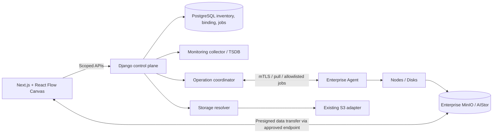

# 02 — Target architecture & source mapping

## 1. Current source observations (from uploaded ZIP)
- `backend/accounts/models.py`: `Tenant(kind=personal|business)`, `Membership(role=owner|admin|member)`, `Workspace`, `QuotaAccount`, Platform Admin identities. `Tenant` là Organization nội bộ; không cần tạo bản sao Organization model.
- `backend/files/models.py:StorageConfig`: FK tenant, provider `local|s3|minio`, `endpoint`, `credential_ref`, unique `(tenant,provider)`; **ràng buộc này không hỗ trợ hai MinIO StorageConfig trong một tenant nếu không migration có chủ đích**.
- `backend/files/models.py:StorageLocation`: FK `storage_config` và `provider_version_id` cho object đã publish.
- `backend/files/models.py:UploadSession`: hiện chưa có FK `storage_config`; S2/S3 routing cần ghim target storage tại init, không chọn lại ở complete/retry.
- `backend/files/storage_adapters/factory.py:get_storage_adapter()`: dùng `settings.SECUREDRIVE_STORAGE_*` toàn cục; cần DI/resolver theo tenant/session, vẫn giữ global path làm fallback legacy.
- `backend/files/storage_adapters/s3_compatible.py`: S3 adapter hiện hữu; tái sử dụng interface, không rewrite SDK.
- `backend/accounts/organization_quota_api.py`: Org owner/admin đã có quyền chỉnh quota tenant/member/workspace. Tách quota storage budget/physical capacity.
- `frontend/components/organization/OrganizationAdminPage.tsx`: hiện có tabs `workspaces|members`; thêm entry Storage giữ chung layout.
- `frontend/app/(admin)/admin/infrastructure/topology/page.tsx`: placeholder; thay bằng canvas interactive, không tạo route thứ hai trùng trách nhiệm.
- `frontend/components/admin/InfrastructureDetail.tsx`: trang hạ tầng có checks hiển thị Unknown; không gọi dữ liệu thật thành HEALTHY.
- `frontend/package.json`: chưa có `@xyflow/react`; thêm chỉ khi S3, pin version tương thích và test build.

## 2. Kiến trúc đích

Notes: MinIO binary transfer không đi qua Platform khi browser truy cập được; enterprise-only network cần gateway/VPN. Control Plane đặt tập trung ⇒ metadata vẫn ở Platform. Nếu yêu cầu metadata on-prem, cần kiến trúc khác.

## 3. Bounded contexts (giữ mô-đun gọn)
- `accounts` → danh tính Organization và membership; RBAC.
- `files` → `StorageConfig`, StorageLocation, UploadSession/Finalization, resolver.
- `infrastructure` (app mới nếu được chứng minh cần): cluster/pool/node inventory, operation job, telemetry summary, audit; không đặt toàn bộ vào `dashboard/views.py`.
- `frontend/components/storage/` (component theo nghiệp vụ, không mỗi button một file): `StorageManager`, `TopologyCanvas`, `NodeInspector`, `ClusterWizard`, shared types/hooks.
- `frontend/lib/storage-control-service.ts` → API client có types và error mapping.

## 4. Storage binding & compatibility
- MVP: tenant business → active StorageConfig. Personal tenant → Platform StorageConfig; không được trộn tenant credentials.
- UploadSession pin `storage_config_id` + `endpoint_config_version` ở thời điểm khởi tạo; dùng cùng target cho part URLs, completion, finalize, cleanup, retries.
- Download/preview dùng `StorageLocation.storage_config`, **không** dựa trên active binding của tenant; file đã tạo không được chuyển provider chỉ vì config mới trở thành active.
- Migrate existing data: backfill old sessions / locations theo global adapter hiện hành (chỉ khi bằng chứng đủ, không suy đoán object key); không tự move object giữa clusters.
- Khi rotate credential/endpoint: versioned secret ref và dual read có thời hạn; idempotent operation, reconciliation.
- Hỗ trợ nhiều clusters/tenant sau MVP khi đã giải quyết unique `(tenant,provider)` và routing đồng bộ.

## 5. Trust boundaries
- Browser chỉ có metadata và short-lived presigned action theo ACL; không có root keys hoặc machine credentials.
- Organization Agent giữ quyền máy chủ/MinIO admin trong mạng doanh nghiệp và kiểm tra policy local.
- Platform DB giữ inventory và references, không plaintext secret; có least-privilege S3 creds theo tenant nếu cần.
- Telemetry source và timestamp phải hiển thị; không suy health từ màu canvas.
