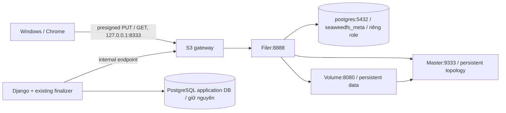

# SeaweedFS development — Task 01

> **Cập nhật P0 16/11/2026:** đích hiện hành là [SeaweedFS-only, Enterprise My Drive và CSE/recovery](../../docs/ADR-0010-seaweedfs-enterprise-and-client-encryption-target.md). [Baseline P0](../../docs/REFACTOR_P0_BASELINE_2026-11-16.md) ghi source/test/runtime gaps mới. Phần cutover phía dưới chỉ giữ lịch sử; các cutover commands không còn trong working tree và không được thực thi. P0 không cấu hình lại service, bật flag, chạy gate ghi live hoặc xóa dữ liệu.

Bằng chứng triển khai PostgreSQL Platform ngày 12/11/2026: [PLATFORM_FILER_POSTGRES_2026-11-12.md](../../docs/PLATFORM_FILER_POSTGRES_2026-11-12.md). [Bàn giao Task 01](../../docs/BLUEDRIVE_BAN_GIAO_TASK01.md) giữ lịch sử; hướng dẫn tạo role trên Windows trong bản cũ không còn áp dụng cho Platform Compose này.

Phạm vi: **development, runtime cần xác minh tại môi trường đích**. Compose dùng SeaweedFS `4.53` và PostgreSQL `17-alpine` riêng cho metadata Platform. Kiểm tra bootstrap/persistence không thay nghiệm thu toàn bộ checksum/browser/finalizer. Không triển khai HA hoặc production bằng cấu hình development này; MinIO cutover không còn là mục tiêu.

Giữ adapter S3, finalization worker, quota, ACL và AES legacy. Dùng provider `s3` hiện có, không thêm schema/provider riêng. Giống như đổi địa chỉ kho: quầy cấp quyền và trạm kiểm hàng vẫn giữ nguyên.



Compose hiện publish S3 `127.0.0.1:8333` và Master HTTP `127.0.0.1:9333` phục vụ monitoring local; Volume/Filer không publish ra host. Network `storage` riêng, không dùng làm mạng chung với container không tin cậy. S3 static credentials bắt buộc: identity operator riêng, identity ứng dụng chỉ Read/Write/List/Tagging trên bucket được chỉ định; tắt embedded IAM để không dùng chế độ cấu hình mặc định cho STS. Không có identity anonymous. Health S3 yêu cầu truy cập anonymous bị 403; gate có signed request mới chứng minh readiness thực sự.

## Chuẩn bị từ PowerShell tại repository root

Cần Docker Desktop Linux engine + Compose, Python 3.12 và dependencies của backend. PostgreSQL metadata được Docker tự tạo, không cần role/DB trên Windows và không dùng chung Enterprise Lab. Đặt `$Python` thành đường dẫn tuyệt đối tới executable chạy được. Cấu hình private `.env`/`.local` đã sinh; **bỏ qua lệnh `configure.py` bên dưới trên máy hiện tại** để giữ credential. Chỉ chạy generator cho cấu hình mới chưa có `.local`.

```powershell
$Python = (Resolve-Path .\.venv\Scripts\python.exe).Path
# Trên máy hiện tại có thể dùng:
# $Python = (Resolve-Path .\.task01-runtime\python\python.exe).Path
$Compose = (Resolve-Path .\infra\seaweedfs\compose.yml).Path
$StorageEnv = Join-Path (Split-Path $Compose) '.env'
& $Python -X utf8 -m unittest discover -s .\infra\seaweedfs -p 'test_*.py' -v
& $Python -X utf8 .\infra\seaweedfs\configure.py
```

`configure.py` đọc `.env.example`, `.env` nếu có và biến môi trường. Sinh secret ngẫu nhiên, `filer.toml`, `s3.json`, CORS, SQL bootstrap và `backend.env` vào `.local/` được Git ignore. Không in secret, không sửa `backend/.env`, không chạy SQL. Nếu `.local` đã có, script dừng để giữ identity hiện tại. Khi cần đổi host/db/origin, chuẩn bị `.env` từ example **trước** khi chạy. Chỉ dùng secret dạng chữ/số/`_`/`-`, ít nhất 20 ký tự. Với Windows, bảo vệ `.env` và `.local` bằng ACL tài khoản hiện tại; không upload chúng vào issue/chat.

## PostgreSQL metadata riêng

Service `postgres` dùng `postgres:17-alpine`, volume riêng `bluedrive-seaweedfs_postgres_data`, không publish port. Docker tạo tài khoản bootstrap `postgres` với mật khẩu ngẫu nhiên riêng trong `.env`, rồi chạy `.local/bootstrap.sql` qua `/docker-entrypoint-initdb.d/01-bootstrap.sql` khi data directory còn mới. SQL tạo `seaweedfs_meta`, role `seaweedfs_filer` có NOSUPERUSER/NOCREATEDB/NOCREATEROLE và bảng `public.filemeta` với khóa chính `(dirhash, name)`. Filer chỉ bật backend `[postgres]`, dùng `postgres:5432`, `createTable=false`; không dùng tài khoản bootstrap. Không in SQL hoặc config private vào log.

```powershell
docker compose --env-file $StorageEnv -f $Compose up -d --no-deps --wait postgres
docker compose --env-file $StorageEnv -f $Compose exec -T postgres psql -U postgres -d seaweedfs_meta -v ON_ERROR_STOP=1 -c '\d public.filemeta'
```

Filer chờ cả Volume và PostgreSQL healthy; healthcheck PostgreSQL dùng TCP để không báo sẵn sàng từ server tạm trong lúc bootstrap. S3 trỏ `filer:8888` trong network Platform và publish `127.0.0.1:8333`, độc lập Enterprise `127.0.0.1:8433`. Tên service `postgres` giống Enterprise nhưng network/volume khác Compose project, giống hai tòa nhà có cùng số phòng nhưng địa chỉ khác nhau.

Nếu volume đã có dữ liệu, Docker không chạy lại init script; kiểm tra owner/schema/login trước, không drop/recreate volume hoặc đổi mật khẩu trong `.env` để chữa lỗi. Không chạy lại generator trên cấu hình hiện hữu. Bản local trước chuyển sang DB container được giữ tại `.local/before-platform-postgres-20261112/`; credential Filer/S3 cũ được bảo toàn, chỉ bổ sung mật khẩu bootstrap và identity bucket test riêng. PostgreSQL trên Windows, DB Django, Enterprise và MinIO không thuộc thao tác này. SSL disable chỉ dùng trong network development riêng; production cần TLS và backup/restore đã nghiệm thu.

## Compose và gate thật

```powershell
docker compose --env-file $StorageEnv -f $Compose config --quiet
docker compose --env-file $StorageEnv -f $Compose run --rm --no-deps s3 version
docker compose --env-file $StorageEnv -f $Compose run --rm --no-deps s3 s3 -h
docker compose --env-file $StorageEnv -f $Compose run --rm --no-deps master master -h
docker compose --env-file $StorageEnv -f $Compose run --rm --no-deps volume volume -h
docker compose --env-file $StorageEnv -f $Compose run --rm --no-deps filer filer -h
docker compose --env-file $StorageEnv -f $Compose up -d --wait --wait-timeout 180
docker compose --env-file $StorageEnv -f $Compose ps
# Chỉ xem logs local; không xuất cấu hình/secret hoặc URL ký vào báo cáo.
docker compose --env-file $StorageEnv -f $Compose logs --tail 50 master volume filer s3
docker compose --env-file $StorageEnv -f $Compose exec master curl -fsS http://localhost:9333/dir/status
$env:SEAWEEDFS_ALLOW_TEST_WRITES = '1'
& $Python -X utf8 .\infra\seaweedfs\smoke.py init-bucket
& $Python -X utf8 .\infra\seaweedfs\smoke.py test
& $Python -X utf8 .\infra\seaweedfs\smoke.py browser
& $Python -X utf8 .\infra\seaweedfs\smoke.py seed-restart
docker compose --env-file $StorageEnv -f $Compose restart postgres master volume filer s3
docker compose --env-file $StorageEnv -f $Compose up -d --wait --wait-timeout 180
& $Python -X utf8 .\infra\seaweedfs\smoke.py verify-restart
```

`init-bucket` chỉ tạo bucket chưa có, bật versioning và CORS; không tự sửa bucket đã tồn tại. Operator credential chỉ dùng cho bootstrap; mọi test S3/browser dùng identity ứng dụng. Không có wildcard origin. Browser gate dùng Chrome thật từ dependency Playwright của frontend: trang harness được intercept tại đúng frontend origin, request S3 vẫn đi qua network và CORS thật; **không chứng nhận toàn bộ UI BlueDrive**.

Chrome hiện kiểm tra quyền Local Network Access khi trang intercept được coi là address space public. Harness cấp `local-network-access` trong browser context tạm, chỉ cho origin được kiểm tra, để mô phỏng người dùng đã chấp nhận quyền; CORS, chữ ký và checksum vẫn được kiểm tra thật. Không đổi Chrome profile hoặc tắt security flag. Xem [Chrome Local Network Access](https://developer.chrome.com/release-notes/142) và [Playwright grantPermissions](https://playwright.dev/docs/api/class-browsercontext#browser-context-grant-permissions). Cần `node` có trong PATH của process chạy `smoke.py browser` và Chrome đã cài.

Trên Windows, resolver hệ thống có thể không nhận `s3.localhost` dù Chrome nhận được. HTTP helper của integration test kết nối TCP tới loopback cho đúng tên này theo [RFC 6761](https://www.rfc-editor.org/rfc/rfc6761#section-6.3), giữ nguyên URL, Host và query đã ký. Đây chỉ là transport của test, không sửa DNS/hosts, endpoint runtime hoặc adapter. Giống gửi tới cùng quầy nhận qua địa chỉ nội bộ: tên người nhận trên phiếu vẫn giữ nguyên.

`smoke.py test` có case dương/âm Put/Get/Head/Delete, Range, presigned PUT/UploadPart/GET, signature hết hạn/sai, multipart/resume/complete lặp/abort, checksum từng part đúng/sai/thiếu/sai signed header, composite checksum Complete/Head, copy, version pinning/delete-all-versions và credential/anonymous/cross-bucket deny. Các lệnh `test`, `browser`, `verify-restart` có thao tác dọn fixture; chỉ chạy khi phạm vi cho phép xóa fixture. Bằng chứng bootstrap PostgreSQL ngày 12/11/2026 trước đó không bao gồm các lệnh này; probe S3 riêng và manifest của lần bootstrap được giữ trong `.local`, không thuộc fixture được dọn bởi các gate sau. Không coi ETag hoặc composite checksum là SHA-256 toàn file. Có API/header/checksum không đáp ứng thì gate **FAIL/BLOCKED**, không bỏ assertion hay hạ integrity để ép pass.

`seed-restart` ghi manifest ghim endpoint, bucket, key, version, size và SHA-256. `verify-restart` từ chối manifest cũ thiếu định danh hoặc khác đích, chỉ dọn đúng version đã đọc và đối chiếu bytes; giữ manifest khi nội dung hoặc cleanup lỗi. Không dùng `delete_object` của adapter ở bước này vì thao tác đó xóa toàn bộ version cùng key. Manifest cũ bị từ chối phải được đối chiếu thủ công, không tự xóa object hoặc manifest để chạy lại. Unit tests của gate dùng mock, không thay nghiệm thu restart thật; restart cần phạm vi được duyệt riêng.

Sau khi ghi object, dùng `docker compose ... exec -T postgres psql -U postgres -d seaweedfs_meta` kiểm tra `SELECT count(*) FROM public.filemeta;`, xác minh bảng tăng sau ghi và nội dung còn sau restart. Ghi lại image digest thực tế bằng `docker image inspect` khi nghiệm thu. Bằng chứng lịch sử CLI/image nằm trong `docs/task01-runtime-evidence/`; kết quả bootstrap/S3/persistence mới nằm trong báo cáo ngày 12/11/2026.

## Regression và worker thật trong test database

P1: default regression dùng [test settings/PostgreSQL riêng](../../docs/DEVELOPMENT.md#41-postgresql-test-riêng), không đọc `.env` hoặc bật live provider từ biến môi trường kế thừa. Chuẩn bị `BLUEDRIVE_TEST_DB_*` và test service trước block đầu; block live phía sau chỉ chạy theo phạm vi identity/fixture được duyệt, không thuộc CI mặc định hoặc P1.

```powershell
& $Python -X utf8 .\backend\manage.py check --settings securedrive.test_settings
& $Python -X utf8 .\backend\manage.py makemigrations --check --dry-run --settings securedrive.test_settings
& $Python -X utf8 -u .\infra\seaweedfs\regression.py
```

`regression.py` chạy từ đúng thư mục backend, tạo test DB tên ngẫu nhiên chưa tồn tại và để Django dọn đúng DB đó sau suite; từ P1 chặn zero discovery/keepdb. Không dùng lệnh `migrate` trên serving DB để chữa test. Để chạy test worker với SeaweedFS thật sau khi có quyền, nạp **fixture env riêng đã được operator duyệt** vào process env riêng (không dùng file serving), hai cờ `SEAWEEDFS_INTEGRATION=1`, `SEAWEEDFS_ALLOW_TEST_WRITES=1` và chọn `--live-storage`. P1.1 còn yêu cầu PostgreSQL test profile/marker đã chuẩn bị theo DEVELOPMENT (không dùng serving DB); `$ApprovedFixtureScope` là namespace fixture đã được operator duyệt, không phải credential. Bucket trong fixture env phải đúng `bluedrive-test-$ApprovedFixtureScope`; không tự tạo bucket, sửa policy/CORS/versioning hoặc đổi credential để qua guard. Endpoint nội bộ chỉ IP loopback HTTP có port; public có thể là `s3.localhost` được HTTP gate ghim TCP loopback. Live vẫn giữ test settings/media tạm/email locmem; chỉ hai provider classes đã review được thực thi, module labels bên dưới là alias của đúng hai classes:

```powershell
Get-Content -LiteralPath $ApprovedFixtureEnv | ForEach-Object {
  if ($_ -match '^([A-Z][A-Z0-9_]*)=(.*)$') {
    [Environment]::SetEnvironmentVariable($matches[1], $matches[2], 'Process')
  }
}
$env:SEAWEEDFS_INTEGRATION = '1'
$env:SEAWEEDFS_ALLOW_TEST_WRITES = '1'
& $Python -X utf8 -u .\infra\seaweedfs\regression.py --live-storage --confirm-live-storage $ApprovedFixtureScope files.tests.test_seaweedfs_integration files.tests.test_seaweedfs_finalizer_integration
Remove-Item Env:SEAWEEDFS_INTEGRATION
```

Test worker không mock S3: gọi upload API, lấy part authorization, upload qua HTTP, reconcile ListParts, complete, chạy `finalize_uploads`, đọc file qua service hiện có, kiểm quota và reject hash sai; gồm file rỗng. Dùng test DB riêng của Django, không tạo tài khoản giả ở DB ứng dụng. Trước khi test, bảo đảm không có tiến trình khác đang dùng cùng test DB.

```powershell
Push-Location .\frontend
try {
  npm.cmd run lint
  npx.cmd tsc --noEmit
  $tests = rg --files components lib -g '*.test.mts'
  node --experimental-transform-types --test @tests
  npm.cmd run build
} finally { Pop-Location }
```

`next/font` cần tải Poppins từ Google Fonts trong build hiện tại. Lỗi mạng ở bước đó là baseline môi trường, không phải lỗi SeaweedFS.

## Lịch sử cutover MinIO — không thực thi

<details>
<summary>Checkpoint 12–13/11/2026 đã bị thay thế; giữ để tra cứu</summary>

**Không dùng các lệnh trong mục này:** ADR-0010 đã bỏ lộ trình copy/cutover; các command/module được mô tả không tồn tại trong working tree P0. Phần còn lại của runbook về SeaweedFS development/qualification không cấp quyền thay dữ liệu runtime.

Quy trình giữ nguyên dữ liệu nguồn theo [ADR-0008](../../docs/ADR-0008-platform-storage-copy-and-publication.md), dùng command `migrate_platform_storage` và adapter S3 chung. Phạm vi là My Drive và Personal Workspace thuộc personal Tenant; Enterprise Lab giữ riêng. Công cụ không đổi endpoint/binding/feature flag, không dừng MinIO và không có thao tác reset/xóa nguồn. Giống chuyển kho: giữ vận đơn gốc, kiểm từng kiện và lập vận đơn đích mới trước khi đổi quầy giao nhận.

Kiểm kê chỉ đọc trước, lưu exact IDs và trạng thái vào **file private mới** trong thư mục có ACL phù hợp. `$PrivateCutover` là thư mục operator đã chuẩn bị, không phải thư mục source hoặc nơi public artifact. Không đưa manifest, approval, backup, key/config hoặc URL ký vào Git/chat.

```powershell
$RunId = (New-Guid).Guid
$Inventory = Join-Path $PrivateCutover "inventory-$RunId.json"
$Manifest = Join-Path $PrivateCutover "migration-$RunId.json"
$Approval = Join-Path $PrivateCutover "approval-$RunId.json"
& $Python -X utf8 .\backend\manage.py audit_storage_cutover --objects --manifest $Inventory
```

Audit không ghi object/DB và không ghi đè manifest đã tồn tại. `--objects` quét toàn bucket nên không kết hợp `--tenant`. Ciphertext legacy chỉ được băm bytes, chưa tự chứng minh khả năng giải mã; `bytes_match=null` là **Unknown**. Khi quyền LIST multipart bị từ chối, trạng thái multipart là **BLOCKED**, không phải 0 upload hoặc kiểm kê hoàn tất. Phân loại staging, version không được tham chiếu và session/job/reservation trước khi thao tác; không dùng nhãn `unreferenced_candidate` làm quyền xóa.

Các điều kiện trước cửa sổ migration:

1. Operator xác minh **StorageConnectionRevision S3 Platform** đã ready, có `verified_at` và không còn lỗi probe; dùng UUID revision, không dùng UUID cluster/binding. Container healthy hoặc smoke pass không tự tạo revision này. Không dùng revision Enterprise để thay Platform.
2. Backup PostgreSQL nghiệp vụ, **đúng các object version nguồn** và metadata/config/key cần đọc AES legacy; giữ các snapshot cấu hình rollback trong nơi private. Restore DB/object thử ở môi trường cách ly, kiểm tra reader/key và bytes, không restore đè hệ thống đang chạy. Gate storage/browser/finalizer và persistence phải có evidence hiện hành.
3. Dừng mọi writer trong cửa sổ chuyển đổi; drain upload/finalizer/reservation và chờ hết hạn các presigned PUT đã cấp. Giữ nguồn không đổi trong toàn bộ copy/verify/publish hoặc rollback. Lock PostgreSQL không khóa writer S3 bên ngoài; `writers_stopped=true` là xác nhận thực tế của operator, không thay thao tác dừng/drain.

Lập plan sau khi nguồn đã ổn định. Lệnh mặc định này chỉ đọc dữ liệu và tạo manifest private mới; chưa copy, chưa đổi đích đọc/ghi:

```powershell
# UUID revision S3 Platform đã được kiểm chứng bởi quy trình connection hiện có.
& $Python -X utf8 .\backend\manage.py migrate_platform_storage plan --target-connection $TargetRevisionId --manifest $Manifest
```

Manifest ghim database, nguồn, revision đích và `plan_sha256`. Mỗi location nguồn có key đích `primary/<uuid5>` xác định theo plan/source; source Version ID và target Version ID được lưu riêng. Không sửa kế hoạch để bỏ qua blocker: nguồn/metadata thay đổi phải kiểm kê và lập plan mới. Command không ghi đè plan hiện hữu; lock `.lock` ngăn hai process dùng cùng manifest. Nếu process gián đoạn để lại lock, operator xác minh process cũ đã dừng trước khi xử lý lock, không tự cướp khóa.

Nếu cần review manifest trước khi đủ gate `ready`, có thể thêm `--allow-unverified-target` **chỉ cho action `plan`**, sau khi revision đã có read check thật. Manifest ghi `qualification_at_plan` và không phải quyền thực thi. Mọi action copy/verify/publish vẫn kiểm `ready`; truyền tùy chọn này cho action ghi bị từ chối. Không gán ready trực tiếp hoặc dùng operator credential thay identity ứng dụng để vượt probe. [Checkpoint 13/11](../../docs/PLATFORM_CUTOVER_CHECKPOINT_2026-11-13.md) ghi một trường hợp LAB probe cần quyền tạo bucket tạm mà identity ứng dụng hiện không có.

**Checkpoint phê duyệt:** trình manifest cùng backup/restore, đối chiếu object, gate storage và phương án rollback trước khi ghi dữ liệu thật hoặc đổi nơi phục vụ. Operator chuẩn bị approval JSON private sau khi review, có cấu trúc:

```json
{
  "plan_sha256": "<digest lấy từ plan đã review>",
  "operator": "<người phê duyệt>",
  "reason": "<lý do cụ thể, tối thiểu 8 ký tự>",
  "writers_stopped": true,
  "actions": ["copy", "publish", "rollback"],
  "evidence": {
    "database_restore": {"path": "<file evidence restore cách ly>", "sha256": "<SHA-256 file>"},
    "source_backup": {"path": "<file evidence backup object versions>", "sha256": "<SHA-256 file>"},
    "legacy_keys": {"path": "<file evidence bảo toàn key/config legacy>", "sha256": "<SHA-256 file>"},
    "storage_gates": {"path": "<file evidence gate hiện hành>", "sha256": "<SHA-256 file>"}
  }
}
```

Chỉ liệt kê các action thực sự được duyệt; mẫu trên không phải approval có sẵn. Các evidence là file hiện hữu, không phải symlink; mỗi SHA-256 là 64 ký tự và phải khớp file khi chạy. Hash chỉ chứng minh evidence không đổi sau duyệt, không tự chứng nhận nội dung evidence hoặc khả năng restore. Không chứa secret trong lý do hoặc báo cáo evidence.

Sau approval đúng manifest/action:

```powershell
& $Python -X utf8 .\backend\manage.py migrate_platform_storage copy --manifest $Manifest --approval $Approval
& $Python -X utf8 .\backend\manage.py migrate_platform_storage verify --manifest $Manifest
& $Python -X utf8 .\backend\manage.py migrate_platform_storage publish --manifest $Manifest --approval $Approval
# Chỉ khi cần hoàn nguyên lô đã công bố và action rollback đã được duyệt:
& $Python -X utf8 .\backend\manage.py migrate_platform_storage rollback --manifest $Manifest --approval $Approval
```

`copy` giữ nguyên bytes/ciphertext và metadata, đối chiếu size/SHA-256 toàn file bằng đọc lại target version, lưu biên nhận atomically sau từng object. Retry dùng key xác định và kiểm lại object có sẵn; không tạo key ngẫu nhiên mới hoặc PUT lặp khi biên nhận đã có. Không dùng ETag/composite checksum làm SHA-256 toàn file. Ciphertext chưa ghim version, checksum metadata chưa phân loại hoặc version/source thay đổi sẽ bị chặn. File tạm cần đủ dung lượng cho object lớn nhất; object vượt giới hạn single PUT cần được phân loại trước.

Nguồn plaintext cũ thiếu header VersionId hoặc có null được ghi `source_version="null"`; command đọc nguồn hiện tại và bắt buộc size/full SHA-256 khớp FileVersion tại copy/publish/rollback. Null không phải pin bất biến, không thay gate dừng writer. Target vẫn cần VersionId thật; ciphertext chưa ghim vẫn BLOCKED. Source config disabled không được dùng làm kế hoạch rollback.

`verify` đọc lại nguồn/đích theo biên nhận, không ghi object hoặc DB; command có thể cập nhật file biên nhận. `publish` kiểm lại cả lô, khóa bảng/kiểm drain và thêm location S3 mới trong một transaction; không sửa identity bất biến của location/revision nguồn, không tạo FileVersion khác và không consumed quota lần nữa. Reader chọn primary available mới nhất; command từ chối thành công nếu location công bố sau đang cạnh tranh làm reader chọn đích khác.

`rollback` kiểm lại bytes/version nguồn rồi chuyển đúng location đích trong manifest về `pending`, giữ nguyên cả object nguồn/đích và metadata lịch sử. Target outage không ngăn rollback nếu revision identity còn khớp và nguồn đọc được; không cần RPC tới target. Với nguồn legacy chưa ghim trong DB, latest version vẫn phải khớp biên nhận để reader cũ đọc đúng bytes. Rollback lô cũ không chuyển ngược file mới phát sinh trên SeaweedFS; giữ reader revision và kho đích để đọc chúng.

Publication location và routing upload mới là hai bước riêng. Sau khi dữ liệu được kiểm chứng và đã phê duyệt, operator dùng API connection/binding hiện có cùng rollout flag theo [S2 runbook](../../docs/STORAGE_CONTROL_CENTER_S2_RUNBOOK.md); không tự bật flag hoặc đổi config nguồn. **Giữ global endpoint/bucket/credential MinIO** khi còn location/session legacy cần đọc, retry, abort hoặc cleanup; không chép `.local/backend.env` đè lên global cũ. Việc drain/xử lý các tham chiếu này phải có manifest và nghiệm thu riêng.

Sau chuyển routing, chạy app live E2E My Drive/Personal Workspace: upload/resume/cancel, download trực tiếp/ZIP, preview/sharing, copy/move/rename/trash/restore, quota/reservation, RBAC/isolation và audit. Chỉ ngừng MinIO khi tất cả tham chiếu đọc/cleanup nguồn đã được đánh giá và xử lý, dữ liệu đích/rollback được kiểm chứng và E2E ứng dụng thật đã nghiệm thu. Không xóa object/volume nguồn, migration history hoặc key legacy để lấy trạng thái hoàn thành. Enterprise Lab không thuộc migration này.

Số liệu inventory, số FileVersion thực sự verified/copied và blocker theo ngày nằm trong [báo cáo cutover](../../docs/PLATFORM_CUTOVER_REVIEW_2026-11-12.md); runbook không coi code hoàn thiện hoặc container healthy là cutover đã xong. Production còn cần HTTPS, network policy, backup/restore và encryption/SSE/KMS đã xác minh; cấu hình một máy không tạo HA.

</details>

## Nguồn đã đối chiếu

- [SeaweedFS 4.53 release](https://github.com/seaweedfs/seaweedfs/releases/tag/4.53)
- [CLI S3 đúng tag](https://github.com/seaweedfs/seaweedfs/blob/4.53/weed/command/s3.go)
- [Filer PostgreSQL config đúng tag](https://github.com/seaweedfs/seaweedfs/blob/4.53/weed/command/scaffold/filer.toml)
- [PostgreSQL store đúng tag](https://github.com/seaweedfs/seaweedfs/blob/4.53/weed/filer/postgres/postgres_store.go)
- [Docker image source](https://github.com/seaweedfs/seaweedfs/blob/4.53/docker/Dockerfile.local)
- [S3 credentials/configuration](https://github.com/seaweedfs/seaweedfs/wiki/S3-Configuration)
- [PostgreSQL Docker entrypoint/init scripts](https://github.com/docker-library/postgres/blob/master/docker-entrypoint.sh)
- [Compose chờ service healthy](https://docs.docker.com/compose/how-tos/startup-order/)
